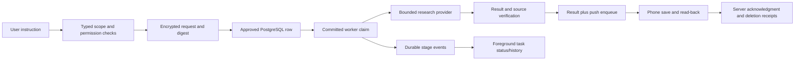

# Background execution and truthful progress

## Existing execution boundary — verified source

`server/messaging/src/errands/` already provides encrypted persistent requests, account-scoped APIs, digest-bound approval, a committed PostgreSQL claim with `FOR UPDATE SKIP LOCKED`, independent worker passes, cancellation polling, time/tool/token budgets, transactional results/push enqueue, acknowledgment and retention cleanup. The iPhone stores `StoredErrand` in its existing persistence repository and adopts server tasks it does not yet have.

The voice connection is a submission/read surface, not the worker's lifetime. Normal iOS background execution is not used as an indefinitely running agent. `CallTask` attempts/results, Studio jobs and backend documents have their own execution models; a single durable task framework for all of them does not exist.

## Implemented progress

Migration `042_errand_progress.sql` adds content-free progress JSON to the existing errand row. It is additive; old requests and old clients remain valid. The record contains a fixed stage, last-update timestamp, observed research request/search/fetch counters and the last 24 events. It contains no task words, URL, title, transcript or arbitrary model text.

| Stage | Producer / evidence |
| --- | --- |
| `running` | Worker has claimed the persisted task and passed the approved-content check |
| `waiting_for_service` | Code is about to await a bounded research-provider request; completed counters are not incremented in advance |
| `researching` | A provider response was received and actual usage/tool-use metadata was read |
| `writing_report` | Research notes exist and the result-writing phase is about to execute |
| `completed`, `failed`, `cancelled` | Existing terminal-state transaction determines the actual outcome |

Counters are monotonic observations, not completion percentages. History is bounded. Updates check account ownership and running state and do not overwrite a cancellation or terminal row. A compare-and-set avoids overwriting another recorded update. Progress-storage failure logs a content-free diagnostic and does not become fabricated progress. The shutdown/cancel check after the initial database write prevents a provider starting after shutdown raced with that write.

The ordinary research runner emits detailed stages. Other researcher adapters, including shopping-specific code that does not yet invoke the optional progress callback, have start/finish observations only. Do not describe that as product-by-product progress.

`GET /v1/errands/:id` exposes the stored history; the list can carry the latest progress. The phone decodes the optional field, persists it with `StoredErrand`, and uses terminal state in preference to an older active-stage label. Existing local records without progress decode normally. Native list/detail view wiring is added, but the iOS UI is **not compiled or visually verified** here.

## Lifecycle mapping

Preserve the existing wire states while introducing an additive user-facing projection:

| Requested lifecycle | Current implementation |
| --- | --- |
| Created | `draft`, or approved `queued` |
| Planning | No separate durable planner phase; do not invent it |
| Running | `running` plus actual stage events |
| Waiting for external service | `running` plus `waiting_for_service` |
| Waiting for user | Existing draft/approval flows; no general resumable question state |
| Retrying | Provider/internal recovery exists in individual subsystems, not a generic task retry state |
| Completed | `done` with a verified result |
| Partially completed | The result can state uncertainty/unconfirmed offers; no new universal wire state |
| Failed | `failed` with a real failure code, including interrupted worker |
| Cancelled | `cancelled`; a late result cannot change it to done |

Replacing every subsystem's state enum in one patch would break clients and confuse provider status with objective completion. A future unified task projection should point to the existing feature's account-scoped record and keep its provider receipt.

## Persistence, recovery and idempotency

- Phone app/session exit: approved server work remains queued/running. The phone re-fetches and adopts it later.
- Worker restart: queued rows survive. Existing running rows are closed as interrupted after the timeout/grace period; this patch does not claim checkpoint resumption.
- Lost approval response: retain unknown and reconcile the original ID. Do not resubmit the natural-language task as a new job.
- Cancellation: queued work stops before dispatch; running work checks cancellation, terminal writes are fenced, and a late successful response does not win.
- Several tasks: the existing worker starts up to its configured process limit and claims rows atomically. No voice-session global singleton owns all task state.
- Account deletion/retention: progress lives on the errand row and disappears with it. It adds no separate content store or processor.

Automatic paid-task retry after a crash needs an explicit attempt/checkpoint model, task-wide cost reservation and a policy for unreported provider usage. Side-effectful tasks additionally need provider idempotency and reconciliation. Those are remaining work, not hidden behind a generic “retry” loop.

## iOS visibility

In-app stages and normal result push delivery are supported by the existing architecture. An ActivityKit UI or an open socket is not proof of background updates after suspension. Reliable server-driven task Live Activities require a real activity token lifecycle, account/task binding, push credentials, update/end events, revocation and a device test. None was fabricated here. Exact current Apple API/lifetime requirements need official-documentation access and a Mac/device validation pass; see [research](DODDY_RESEARCH_AND_TECHNOLOGY_REVIEW.md).

Deployment needs migration 042 before the changed worker/API, then a compatible iPhone build. No production migration or deployment was performed.
