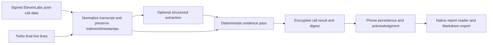

# Calling and evidence-based reports

## What exists

The repository already has call cases, one-to-three-place tasks, dedicated inquiry/booking/order agents, Twilio dispatch, an ElevenLabs voice bridge, signed callback processing, live transcription, takeover/end controls, time/country/number/cost limits, encrypted results, pushes, optional result SMS and provider-deletion reconciliation. Relevant implementation is in `server/messaging/src/taskCalls/`, `providers/taskCalls.ts`, `routes/callCases.ts`, `routes/taskCallWebhooks.ts`, `Packages/DoddyCore/CallTask.swift`, `CallCasesClient.swift`, and `DoddyApp/Features/CallCases/`.

This is **VERIFIED in source/local mocks**, not a live call certification. There are no new real-call attempts in this audit. Current phone-number provisioning, enabled agent IDs, account access, model/language quality, caller identity, billed costs and carrier failures are **NOT YET VERIFIED**.

## Dispatch and authorization

The initial request can authorize one tightly scoped inquiry. The app validates its recent user transcript, destination provenance, exact question, effect and language, then approves the server's compiled digest once. It does not send a model-generated `approved=true` flag. Bookings, orders, recordings/disclosures, ambiguous contacts, changed questions, deferred calls and unsupported languages retain the existing review flow. `text_result` defaults to false; calling does not silently add an SMS.

The number can come from a structured live listing or be explicitly provided by the user. It is not extracted from arbitrary prose. Typed/user-provided provenance is preserved separately from a listing source. A known name must be distinctive and unambiguous. “Call my mechanic” is not authorization to pick a random business whose listing happens to be named “The Mechanic”. A contact resolver that can prove the intended contact/number and a typed selection rule for “find a good dentist and call them” remain integration work.

The existing server still compiles and encrypts a fixed payload, verifies its digest at approval, claims an attempt and rechecks gates before dialing. Unknown creation/dial results are not retried as a new call. A new user request/card is required where existing retry policy permits another attempt. A reported `started` means dispatch began; it does not mean connected, answered or booked.

## Reporting pipeline and the identified loss

Before this change the writer selected one answer line and wrote a short summary/next step. The quote's span was checked, but the free-form summary and suggested next step were not equivalent to that evidence check. Multi-part answers, dates, prices, conditions and follow-ups had no structured report representation. The worker already retained transcript evidence long enough to produce a richer result; the limitation was not simply card formatting.

## Implemented extraction and second pass

`taskCalls/writer.ts` can return up to 15 objective-relevant facts: answer, person, organization, date, time, price, location, condition, commitment, open question or follow-up. Each has a source line, exact excerpt, value copied from that excerpt and uncertainty flag. The existing verified answer excerpt is included as well.

`taskCalls/report.ts` performs a separate deterministic pass:

1. The referenced line must exist and belong to the callee, not Doddy.
2. The excerpt must occur verbatim in that line, and the value must occur in the excerpt. Dates/prices are preserved as spoken; guessed absolute dates and currency conversions are rejected.
3. Uncertainty is inspected in the full source line, so cropping “maybe” out of a quote cannot make its value certain.
4. A commitment needs explicit, unnegated, nonconditional commitment wording. Mere availability is not an agreement. Even an accepted commitment is labeled a **reported statement**, not an independent booking receipt.
5. Duplicates and overlong/unbounded material are excluded. Rejected candidate count is retained.
6. Numeric source details without representation in the accepted findings produce a bounded coverage-review signal. This is a conservative omission check, not proof of semantic completeness.

The free-form model summary is no longer accepted as a separate factual paragraph merely because one quote was valid. A source excerpt is used instead. Arbitrary model next-step prose is replaced by the existing coded recovery suggestions; source-reported follow-ups can appear as evidence facts.

The transcript is normalized before sending it to the writer and again idempotently at result construction, keeping model/report line numbers aligned. Time references come from real transcript metadata; no invented timestamps are inserted. The report is part of the encrypted result/digest, persisted by the phone's existing Codable store and retained after server acknowledgment.

Call-chain decisions also require a grounded writer answer. A hedged yes cannot conclude success, and an unsupported no cannot trigger the next place. Existing exact-booking/order confirmation checks remain.

## User-facing document

The native reader shows objective, actual call outcome, evidence findings, uncertainty and a partial-report notice when needed. Polish/English headings are supported. It presents only populated fact categories; restaurant prices/conditions, appointment dates and support follow-ups do not require empty template sections.

Markdown export uses a real user-selected file through the system file exporter. The core renderer escapes active Markdown/HTML and preserves source excerpts and evidence references. UTF-8 file round-trip and escaping are tested on Linux. The SwiftUI reader/export wiring is **not compiled or visually verified** in this environment. PDF/DOCX conversion is **not implemented**; it should use the same canonical report, not another unconstrained summarizer.

Raw transcript access remains behind `mayReadTranscripts`/`withoutTranscript`. The result exposes bounded report excerpts rather than turning on full transcripts for everyone. Existing account encryption, acknowledgment, provider cleanup, deletion and retention are not replaced. No historical call records were downloaded or included in these documents.

## Quality limits and rollout

Verbatim support is stronger than a free-form summary but does not prove relevance, correctness of transcription or complete extraction. The coverage heuristic is conservative; names, dates written only in words and unstated implications need domain-specific golden cases and human review. An optional model review can flag omissions, but cannot turn an unsupported claim into verified evidence.

The writer still makes one model request; its output cap rises from 2,000 to 4,000 tokens to fit structured facts. Actual cost/latency was not measured against production. Keep existing operator caps and compare real usage before changing them.

Deploy the API/worker with the additive migration and a compatible phone build. Older phones ignore the report field and may acknowledge/delete the server copy after saving only their older card shape; old call reports cannot be promised a retrospective upgrade. Sync repository prompt/tool changes only after a compatible build and reviewed live diff. Current configured task-call language is Polish; an English-capable agent/bridge must be proven before claiming English call reliability.

Acceptance still needs an operator-owned authorized test number: verify recipient, dispatch/answer/end events, voicemail, refusal, wrong number, noise, takeover, callback failure, report facts/omissions, deletion and receipt. Automated tests remain mocked; this audit authorizes no real third-party test calls.
