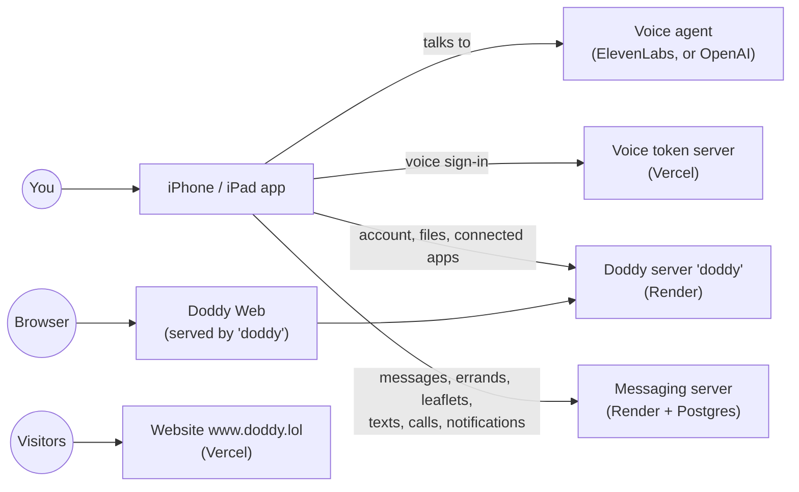

# Doddy

**An AI mate for your iPhone. Asks first, always.**

Doddy is an app for iPhone and iPad that you talk to. You say what you need in a sentence, for example "move the dentist to 2 and remind me to buy bread". Doddy turns it into a card that shows exactly what it will do. Nothing happens until you tap. Doddy is a cartoon character and clearly an AI, not a person.

This repository holds everything: the iPhone app, the servers behind it, Doddy Web (a browser version for the same account), the website [www.doddy.lol](https://www.doddy.lol) and all the documents.

> **Where things stand (7 Nov 2026).** The app is in testing: CI builds it and runs its tests in the simulator, and the owner runs it on their own iPhone, but it is not on TestFlight or the App Store yet. Doddy Web and the website are live. The Apple Watch and Mac apps are paused. [STATUS.md](STATUS.md) is the one page that says what is live and what is open right now.

## How Doddy works

Three promises shape the whole app. They are written down in [docs/trust/](docs/trust/README_START_HERE.md) (the "constitution"), and the code enforces them, not just the AI's instructions:

1. **Asks first.** Anything that changes something outside the app (an event, a message, a list someone else sees) is shown as a card with the exact details. Doddy acts only after you tap, and only on what the card showed. If anything changes, he asks again.
2. **Never pretends.** Doddy says something is done only after the other service confirms it. He says he saved or forgot something only after the phone's database really did it. If he doesn't know, he says so.
3. **Your notes stay on your iPhone.** Memory lives in a database on the phone. Settings › Privacy › "What leaves this iPhone" lists what is sent where, and when.

<!-- WHAT-WORKS -->

## How the parts fit together



- **The app** does most of the work itself: it keeps your notes and lists in a database on the phone, and reads your calendar, reminders and contacts through iOS, only after iOS asks you.
- **The voice agent** is the AI you hear. Its instructions and tools are in [`voice-agent/`](voice-agent/README.md). When it wants to do something, it asks the app, and the app shows you the card.
- **The servers** do what a phone can't do alone: sign in, send a text or a push notification, read this week's shop leaflets, run a longer errand.

## What's in this repository

| Folder | What it is |
|---|---|
| [`DoddyApp/`](DoddyApp/) | The iPhone and iPad app (SwiftUI). One folder per feature in `DoddyApp/Features/`. |
| [`Packages/DoddyCore/`](Packages/DoddyCore/) | The app's rules and memory database, with no screens, so they can be tested on any computer. |
| `Shared/`, `DoddyWidgets/`, `DoddyShare/` | Code shared with the Home Screen widgets, the widgets themselves, and "Save to Doddy" in the Share menu. |
| `DoddyTests/`, `DoddyUITests/` | The app's tests. UI tests drive the app in the iPhone simulator. |
| [`voice-agent/`](voice-agent/README.md) | What the voice agents are told and which tools they have: the main agent, the phone agent and the task-call agent. |
| `backend/` | The main server (`doddy` on Render): accounts, connected apps, documents Doddy makes, and Doddy Web. |
| [`web/`](web/README.md) | Doddy Web, the browser app for the same account. |
| [`server/messaging/`](server/messaging/README.md) | The messaging server: messages, errands, shop leaflets, texts and calls, push notifications. |
| [`server/voice-token/`](server/voice-token/README.md) | Hands the app a short-lived pass to start a voice conversation. |
| [`gateway/`](gateway/README.md) | An older assistant server. The app no longer uses it. |
| [`site/`](site/README.md), [`blog/`](blog/README.md) | The website www.doddy.lol and its blog. |
| [`l10n/`](l10n/README.md) | Translations of the app and the website. |
| `tools/`, `scripts/` | Generators (translations, website pages, colours) and the checks CI runs. |
| `Config/`, `project.yml` | Build settings. The Xcode project is generated from `project.yml`, never committed. |
| [`docs/`](docs/) | Everything written down: plans, decisions, status pages, research. Map below. |
| [`design/`](design/), `assets/` | Design references and brand files. |
| `DoddyWatch*/`, `DoddyMac*/` | Apple Watch and Mac apps: **paused**, not built (ADR-572). |
| `reference/`, `prompts/` | The research and instructions the project started from. History, not instructions. |

## Build and test

**On any computer** (macOS or Linux, with Swift 6, Python 3 and Node 22):

```bash
make test-core
```

```bash
scripts/ci.sh --only checks
```

The first runs the tests of the shared package; the second runs the repository's own checks (translations, generated pages, privacy manifest, guard rules). `scripts/ci.sh --only swift,backend,node,messaging` runs the rest of the server and package tests.

**On a Mac with Xcode** (to build the app):

```bash
brew install xcodegen
```

```bash
make project
```

Then open `Doddy.xcodeproj`, choose the scheme **Doddy** and an iPhone simulator, and press Run. With a free Apple account use `make project-iphone` instead (a few features that need a paid account are switched off).

GitHub Actions checks every pull request: Linux jobs for the checks, the package and the servers, and, when a change can affect the app, a Mac job that builds it and runs its tests in the simulator. Every commit on `main` runs all of them. Details, and how to run a server on your own computer: [BUILD_AND_TEST.md](BUILD_AND_TEST.md).

## Working on Doddy

- **Coding agents (Claude Code, Codex):** read the last section of [AGENTS.md](AGENTS.md), "Current working rules — read this section first". It wins over everything older in that file.
- **Branches:** start from `main`, one topic per branch and pull request. Changes reach `main` only through pull requests, and the owner reviews and merges them.
- **Before you change a platform,** read its page: [iPhone and iPad](docs/platforms/iphone.md), [Web](docs/platforms/web.md), [how the code is split](docs/platforms/README.md).
- **Records:** a decision gets its own file in [`docs/decisions/`](docs/decisions/README.md); what a pull request changed gets a short note in [`changes/`](changes/README.md). Older decisions, ADR-001 to ADR-812, are in [DECISIONS.md](DECISIONS.md): search it by number, it is too big to read.
- **Never** commit a key or password. Secrets live in 1Password; [`secrets/manifest.json`](secrets/manifest.json) lists their names only ([how](docs/security/SECRETS_1PASSWORD.md)).

## Where to read more

| You want to know | Read |
|---|---|
| What is live, what is broken, what's next | [STATUS.md](STATUS.md) |
| What waits on the owner | [docs/OWNER_QUEUE.md](docs/OWNER_QUEUE.md) |
| What each part of the iPhone app does, and its status | [docs/platforms/iphone.md](docs/platforms/iphone.md) |
| How to build, test and run the servers | [BUILD_AND_TEST.md](BUILD_AND_TEST.md) |
| Doddy's rules: behaviour, memory, privacy, character | [docs/trust/](docs/trust/README_START_HERE.md) |
| Design: colours, type, how Doddy looks and speaks | [design/brand-v2.2/](design/brand-v2.2/README.md), [docs/design/](docs/design/README.md) |
| The voice agent's instructions and tools | [voice-agent/README.md](voice-agent/README.md) |
| The latest engineering audit and its plan | [docs/engineering/AUDIT_2026-11-07.md](docs/engineering/AUDIT_2026-11-07.md) |
| Why something was decided | [docs/decisions/](docs/decisions/README.md), then [DECISIONS.md](DECISIONS.md) by number |
| Third-party code and licences | [DEPENDENCIES_AND_LICENSES.md](DEPENDENCIES_AND_LICENSES.md) |

## History

The repository started on 8 October 2026 as a documentation pack: a product plan, research and design mock-ups, with no code. The pack's original front page is kept unchanged in [docs/archive/imported-pack/](docs/archive/imported-pack/README.md). Some of the pack's planning documents are still in place (`docs/00_START_HERE/`, `docs/product/PRODUCT_REQUIREMENTS.md`, `docs/implementation/MILESTONES.md`, `prompts/`, `reference/`). Read them as the October plan: much has been built since, and some of it changed. When they disagree with the code or with `STATUS.md`, the code and `STATUS.md` are right.
