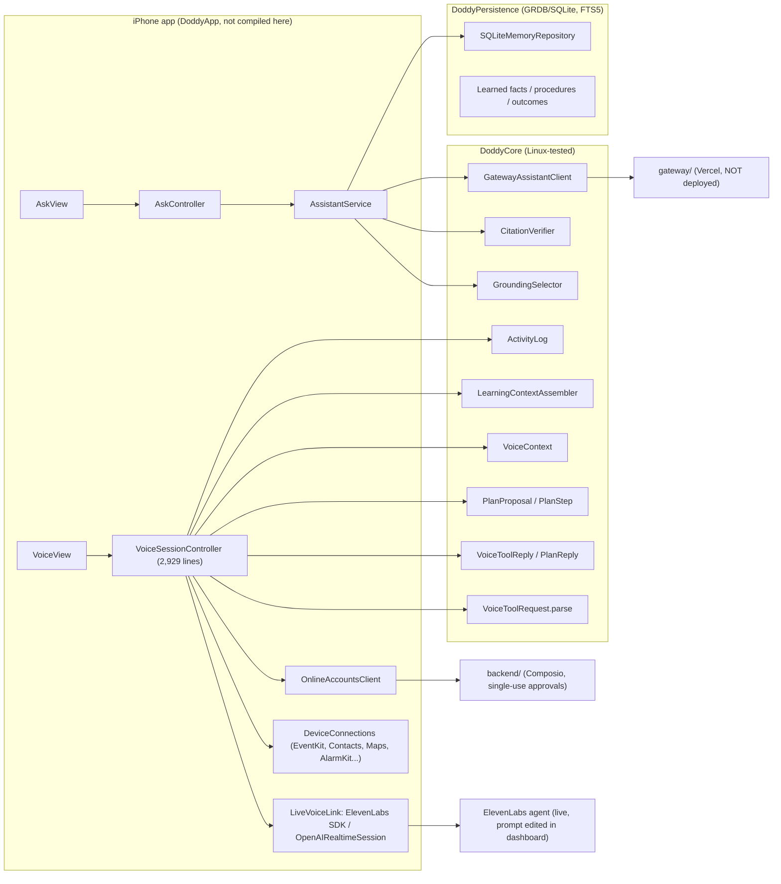

# DODDY Brain 00: Current state (audit, 2026-10-12)

Audit of HEAD `ce02763` on `claude/wizardly-planck-xmn06p`. Toolchain used: Swift 6.3.3 on Linux (no Xcode).
"FIXED" for app code means *the source changed*. No app fix in this repo has been compiled by Xcode (see
`BUILD_AND_TEST.md`: hosted macOS CI has never run a step).

Status words: **IMPLEMENTED** (code exists and the Linux tests that cover it ran), **PARTIAL**, **MOCKED**, **PLANNED**,
**MISSING**, **BLOCKED BY PLATFORM**, **REQUIRES LIVE VERIFICATION**.

## 1. Current architecture

## 2. Inventory (file-referenced)

| Subsystem | Status | Where |
|---|---|---|
| Local memory (save, edit, delete, export, restore, corrections) | IMPLEMENTED | `DoddyPersistence/SQLiteMemoryRepository.swift`, `Ports.swift:20` |
| Lexical recall (FTS5 + typo/number/PL-EN matcher) | IMPLEMENTED | `SQLiteMemoryRepository.swift:65-110`, `RecallMatching.swift` |
| On-device meaning search | IMPLEMENTED (Find only; never sent to a model) | `MeaningSearch.swift` |
| Private notes filter | IMPLEMENTED, but applied per call site (6 places) | `PrivateNotes.swift:62`, `AskView.swift:223`, `VoiceSessionController.swift:392,1702,1707` |
| Typed Ask (recall → grounding → gateway → citation check) | IMPLEMENTED in core; gateway REQUIRES LIVE VERIFICATION (never deployed) | `Assistant/AssistantService.swift`, `gateway/` |
| Voice conversation (ElevenLabs) | IMPLEMENTED in app source; REQUIRES LIVE VERIFICATION | `VoiceSessionController.swift`, `LiveVoiceLink.swift` |
| Voice via OpenAI Realtime | PARTIAL (test provider) | `OpenAIRealtimeSession.swift`, `RealtimeVoice.swift` |
| Voice tool parsing (typed validation of model calls) | IMPLEMENTED | `VoiceTools.swift:229` (`VoiceToolRequest.parse`) |
| Tool approval cards (one pending card, tap to run) | IMPLEMENTED in app source | `VoiceSessionController.swift:779-1065, 2318` |
| Exact-payload approval binding | PARTIAL: server-side for online accounts only (`approvalDigest`, single use, 120 s) | `backend/src/tools/service.ts:417,730`; phone tools approve "the card as shown" (`docs/trust/REPO_ALIGNMENT.md`) |
| Multi-step plans (≤5 steps, ticked, approved once) | IMPLEMENTED | `Plan.swift`, `VoiceSessionController.swift:1921-2149` |
| Action status / unknown outcomes | IMPLEMENTED (`ActivityOutcome.notSure`, `inProgress` → `notSure` after crash; server `outcome_unknown`) | `ActivityLog.swift:36,430`, `service.ts:490-507` |
| Learning loop (facts, procedures, outcome events, gaps) | IMPLEMENTED (Phase C), voice only | `Learning/`, `docs/architecture/LEARNING_LOOP.md` §13 |
| Capability catalog | PARTIAL: product-level, gates UI only, no tool names | `Capabilities.swift` |
| Per-tool policy (risk, confirmation, timeout) | PARTIAL: split across `tools.json` `x_doddy`, `CloudToolName.writes`, `VoiceConnection.serving`, `PlanTool.allowed`, and the controller's switch | see 04 |
| Generic `ToolExecutor` / `ToolProposal` ports | MOCKED (only `UnavailableToolExecutor`; voice bypasses them) | `Ports.swift:159-209`, `AppEnvironment.swift:57` |
| Shared brain / orchestration boundary | **MISSING before this change**; Phase 1 adds it for typed questions | `Brain/` (ADR-442) |
| Proactive (morning check-in, evening wrap-up, note reminders, push/text/calls) | PARTIAL; needs the messaging server for remote parts | `MorningCheckIn.swift`, `EveningWrapUp.swift`, `server/messaging` |
| Background monitoring | BLOCKED BY PLATFORM for unrestricted runs (iOS); PLANNED server-side | 08 |
| Web tools (weather, geocode, Wikipedia) | IMPLEMENTED on ElevenLabs only (`runs_on: web`); OpenAI path says "not available here" | `voice-agent/tools.json`, `VoiceSessionController.swift:663` |

## 3. Dependency map
- `DoddyCore` depends on Foundation only (plus swift-crypto on Linux). `DoddyPersistence` → `DoddyCore` + GRDB. The app depends on both.
- Voice is **not** composed in `AppEnvironment`: `VoiceSessionController(store:)` is created in `VoiceView.swift:78` and `WakeWordListener.swift:332` and reaches about ten singletons and `UserDefaults` directly.
- Prompts and tool schemas for voice live in `voice-agent/` (source of truth) and are pushed to ElevenLabs by hand; the README says several fixes are not live.

## 4. Duplication and coupling
1. **Three context builders with different rules.** Voice start sends the newest shareable notes up to 6,000 characters whatever the question (`VoiceContext.savedNotes`). `search_memories` sends the top 5 matches (`VoiceToolReply.search`). Ask sends matched notes only (`GroundingSelector`, 5 notes, 12,000 scalars).
2. **Greedy budget fill written twice** (`GroundingSelector`, `LearningContextAssembler`).
3. **Tool policy encoded five times** (see §2). Only the online-account subset is cross-checked by a test (`RealtimeVoiceTests.swift:28-41`).
4. **Voice owns the brain.** Routing, gating, approval, execution, logging and reply all sit in `VoiceSessionController.handle` (`:1674-1919`), which Linux cannot compile.
5. **Ask and voice share only `RecallService`, the private-notes filter and record types.** Ask has no profile, no learned facts and no tools; voice has no citation check.

## 5. Known reliability and security issues (from the 2026-10-11 reviews, re-checked against code)
| # | Issue | Status | Evidence |
|---|---|---|---|
| 1 | A tool call from an ended conversation can still show its card, or reply, in the next one (cloud `prepare`, recall, Maps finish after End + Start) | **FIXED in source** (ADR-443; not compiled, Mac checklist 5c) | `handle` checks `isLive` only on entry (`:1676`); `propose` checks `isLive`, not the start attempt (`:2318`); `reply` sends to the current `conversation` (`:2776`) |
| 2 | Typed questions that match an imported note fail as a whole ("memory-source" → "Shorten it and try again") | **FIXED by this change** (ADR-442) | `gateway/src/validate.js:18` vs `GroundingSelector` |
| 3 | Reinstall orphans the server memory copy | OPEN | `ServerKeychainStore.swift:58-66` |
| 4 | Late OAuth completion can leave a Composio grant live | OPEN | `backend/src/store.ts:205-215,307-310,411` |
| 5 | Prompt and tool fixes not on the live agent | OPEN (owner action) | `voice-agent/README.md:42-62` |
| 6 | Privacy screen rows incomplete (Network, Cloud AI) | OPEN | `SettingsView.swift:242-253` |
| 7 | Note text kept in undo payloads for 30 days; Delete all leaves the activity log | OPEN | `ActivityUndo.swift:24-30`, `SettingsView.swift:744-756` |
| 8 | List edits by voice have no card; `{{learned_context}}`/`{{user_profile}}` sit outside DATA markers | OPEN | `voice-agent/instructions.md:24-41,117` |
| 9 | Idempotency keys and the account-creation guard are per client instance | PARTIAL | `ServerClient.swift:195-268` |
| 10 | No app fix compiled; no tests for stale callbacks | OPEN | `DoddyTests/VoiceSessionControllerTests.swift` |

## 6. What should explicitly NOT change
- `VoiceToolRequest.parse`, `VoiceToolReply` prefixes, `PlanProposal`, `ActivityOutcome`: the agent rules, activity log and plan summary read these exact strings.
- The live ElevenLabs agent, its tool ids and `voice-agent/` (no live config changes without the owner).
- SQLite schema and migrations; no second memory store, no embeddings sent anywhere, no vector DB.
- The server-side approval model for online accounts (single-use, digest-bound).
- Byte-locked pack files (`docs/architecture/*.md` from the pack, `README.md`); `AGENTS.md`/`CLAUDE.md` are append-only.
