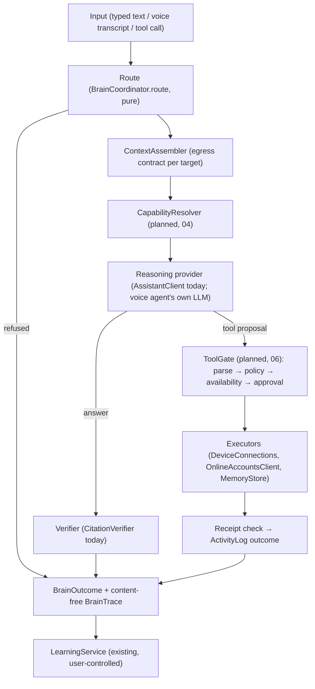

# DODDY Brain 01: Architecture

**Goal:** text and voice reuse the same typed rules for route, context, capability, approval and verification.
Provider transports (ElevenLabs, OpenAI Realtime, the gateway) stay behind small adapters. This is not a rewrite.
Each component is extracted from code that already works, behind tests, one workflow at a time.

## Target shape

| Responsibility | Component | Status |
|---|---|---|
| Coordination of one request | `BrainCoordinator` (`DoddyCore/Brain/BrainCoordinator.swift`) | **Built (Phase 1), typed only** |
| Route decision (consent, input, notes allowed) | `BrainCoordinator.route` | Built |
| Context selection under egress rules | `ContextAssembler` (`DoddyCore/Brain/ContextAssembler.swift`) | Built for `assistantGateway` |
| Reasoning | `AssistantService.answer` → `AssistantClient` (replaceable port) | Existing, re-used |
| Result verification | `CitationVerifier` | Existing, re-used |
| Diagnostics | `BrainTrace` (counts and decisions, no text) | Built |
| Capability registry and resolver | `ToolCatalog` + `CapabilityResolver` | Planned (Phase 3), design in 04 |
| Tool gate | `ToolGate.decide` (`DoddyCore/Brain/ToolGate.swift`), called by `VoiceSessionController.handle` | **Built** (ADR-444) |
| Stale-session guard | `ToolCallOwnership` (`DoddyCore/Brain/ToolCallOwnership.swift`) | **Built** (ADR-443) |
| Learning | `LearningService` | Existing; unchanged |
| Character | `PersonalityPrompt`, `voice-agent/instructions.md`, `docs/trust/02_*` | Existing; never consulted for permissions |

## Rules the boundary keeps
1. **Code routes; the model proposes.** `route` runs before any search or network call and is a pure function of the request and the stored policy.
2. **One egress contract per destination.** `EgressTarget` says which note sources, budgets and learned items may go. No caller builds its own context for that destination.
3. **No new state.** The coordinator holds no chat, memory or action state. Chats stay in the UI (in memory); actions stay in `ActivityLog`.
4. **The trace carries no content.** It holds the route, counts and booleans, so it can feed evaluations without copying the user's words.
5. **Short path first.** A typed question costs one local search plus one model call. Nothing plans, loops or calls a tool unless asked.

## Why not one big agent loop now
The live voice agent already *is* the reasoner for voice: ElevenLabs runs the LLM and calls client tools. Re-hosting that
loop in the app would mean a new provider integration, new costs and new failure modes. The shared value lies in the
typed layer the model calls into: gates, context, approvals and receipts. Phase 3 moves those out of
`VoiceSessionController` into the core.
