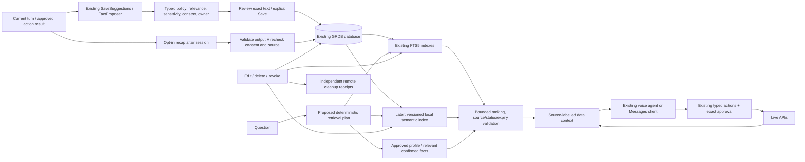
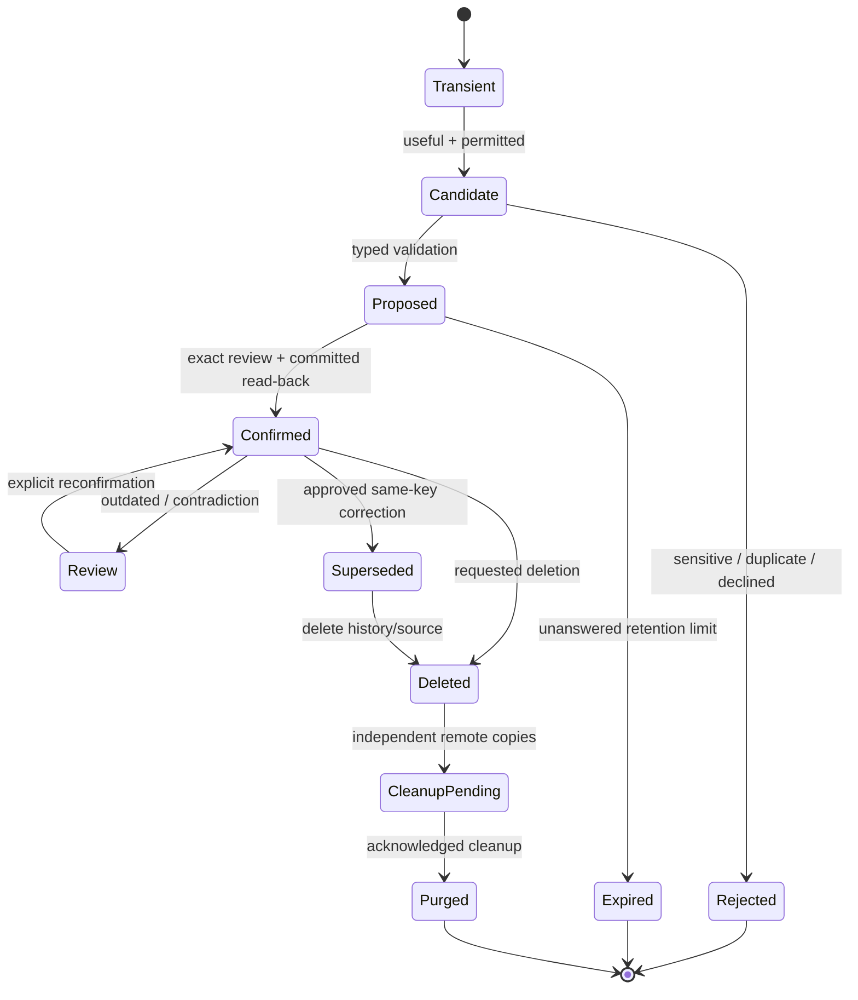
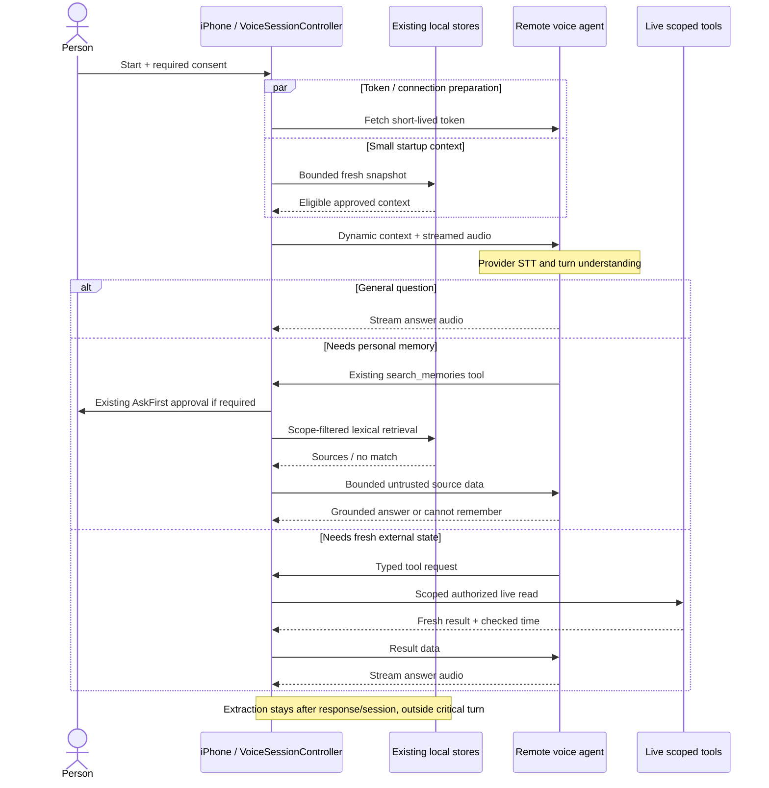
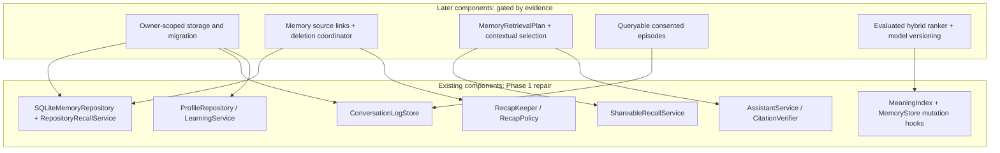

# Recommended DODDY intelligent memory design

Date: 10 November 2026. Status: **recommended design; only the focused repairs listed in IMPLEMENTATION are implemented**. Baseline and evidence: [AUDIT](DODDY-MEMORY-RAG-AUDIT.md). Alternatives and sources: [RESEARCH](DODDY-MEMORY-RAG-RESEARCH.md).

## Decision

Keep `DoddyDatabase` as the local source of truth, `ProfileRepository` for reviewed fields, `LearningService` for confirmed facts/procedures, and the existing lexical recall port for notes. Make retrieval permission-aware before ranking and recheck after asynchronous work. Keep generated summaries separate from explicit user facts. Build a queryable, owner-scoped episodic archive only after consent, source deletion and account migration are designed. No new vector database, framework, embedding service or cloud synchronization is part of this patch.

### Diagram 2: proposed intelligent memory

## Memory taxonomy and truth

| Category | Authority and retention | Existing component / proposed addition |
|---|---|---|
| Working | Recent current-session turns/task state; transient unless separately enabled | Existing SDK/session state, `ThreadRules`; summaries never overwrite source facts |
| Long-term personal | Explicit note or reviewed/confirmed fact; source, confirmation time, expiry | `MemoryRecord`, `ApprovedProfile`, `LearnedFact`; preserve separate source types |
| Episodic | “Discussed X on date”; speaker and source references, bounded retention | Existing recent JSON and recap notes; proposed queryable owner-scoped conversation archive |
| Project/task | Decisions, requirements, unfinished work with project scope and status | Existing decision/commitment categories and errands; proposed project relation only when needed |
| Connected knowledge | Snapshot with `checkedAt`, source ID, account/permission, freshness policy | Existing live tools; refetch events/prices/availability for actions |
| Behavioral preference | Explicit confirmed preference versus unconfirmed candidate | Existing `FactProposer` and learning lifecycle; do not infer sensitive profiles |
| Procedural | Suggested tool sequence; no authority to execute | Existing `Procedure`; every run still validates permission and approval |

A statement by the assistant, a third party, an imported document or an extraction model must not silently become “the user told me.” Store `speaker`, source class, observed time, valid time if known and confirmation independently. Treat all retrieved text as data. Negative/uncertain statements (“might move,” “mostly jazz recently”) stay tentative or episodic; they do not overwrite a stable preference automatically.

## Storage and migration design

**Reuse now:** `memories`, `memory_corrections`, `profile_fields`, `learned_facts`, `learned_fact_revisions`, `procedures`, `outcome_events`, `thread_messages`, recording links and FTS tables. Preserve stable UUIDs and all merged migration names. Phase 1 requires no schema migration.

**Required before expanded multi-account recall:** choose per-account database/container partitioning with a stable authenticated subject identifier, or add an enforced owner column to every participating table and query. Prefer per-account files to avoid accidentally unscoped queries. Keep an unowned legacy installation database quarantined until its owner explicitly claims it; signing in must never automatically assign previous notes to the new account. Partition profile, logs, learned data, private-ID settings, pending jobs, media, widgets, Spotlight and remote sync together. Stop voice and clear in-flight requests/context on identity changes. Keychain account keys must not depend on a display email or provider access token. Account switching tests are a release prerequisite. This design is proposed, not implemented.

**Later additive schema, only after owner migration decision:**

| Entity | Minimal fields / relationships | Reason |
|---|---|---|
| `conversations` | UUID, authenticated owner scope, started/ended, private/consent class, retention deadline | Searchable opt-in episodic source; replaces JSON gradually, not a parallel indefinite archive |
| `conversation_messages` | UUID, conversation FK cascade, ordinal, speaker, text, observed time | Provenance and bounded excerpts; never assume assistant words are user facts |
| `memory_sources` | memory/fact ID, source type/ID, message range, content digest, extraction/index version | Cascade or retire derived data when a source is deleted |
| Fact extensions | optional subject/predicate key, valid_from/to, superseded_by, uncertainty/confirmation | Explicit temporal update without removing historical truth |
| Project relation | stable project UUID and links to existing memories/tasks | Scope retrieval, avoid duplicating note text |
| Optional embeddings | record ID, content digest, model ID/revision, dimension, vector, index version | Derived/disposable; one model space per query; cascade deletion |

Use one additive migration per reviewed slice; verify upgrade from populated baseline, rollback compatibility and foreign-key cleanup. Old binaries must refuse newer schemas rather than reset. Rollback of an additive feature generally means disable its read/write path; do not blindly drop tables holding user records. Before rewriting JSON into SQLite, test crash-safe import, exactly-once IDs and post-import deletion of the old authoritative file.

Local OS Data Protection is already used; do not describe it as application-level database encryption. If a threat model requires encryption beyond device protection, evaluate GRDB/SQLCipher separately with Keychain keys, locked-device/background implications, backups, extensions and key-loss recovery. Do not add crypto merely to decorate the architecture. Server copies remain processor-readable unless deliberately redesigned end-to-end.

## Write pipeline

1. Preserve working context for the session. Explicit “remember this” proposes the exact note/preference, never auto-saves every disclosure.
2. Reuse deterministic SaveSuggestions/FactProposer and existing action results. Exclude secrets, sensitive categories and third-party personal details; current word filters are defense in depth, not perfect classification.
3. Check current owner, memory mode, source permission, retention, duplicate/evidence digest, and candidate usefulness. A repeated sentence does not prove a stable preference.
4. Look up existing active records by explicit canonical key where available. No safe key? Offer a possible related record rather than automatically merging it.
5. Present exact proposed text plus add/update choice. Persist under transaction/read-back. Only then show saved status and update indexes.
6. Recap after the session/idle time only under its own policy. Revalidate the consent epoch, owner and source existence after each model await and before saving. A cancelled/revoked job cannot restore deleted memory. Pending background work needs a bounded journal and cancellation; ordinary Swift tasks are not guaranteed to finish after suspension.

**Conflict example:** a confirmed employment update for the same subject/predicate closes Company A's valid interval and adds Company B, linking both to source and revision. “I joined B” is not sufficient to infer every other employment fact is false. “Jazz recently” is a dated listening observation unless the person confirms replacing their music preference. For contradictory notes without a trusted update, retain provenance, retrieve both and ask a focused question. Recency influences ranking, never independently decides truth.

### Diagram 4: memory lifecycle

This full lifecycle is a proposal. Existing notes use correction history and hard deletion; learned facts already support part of the proposed/confirmed/rejected/retired/expired lifecycle.

## Retrieval plan

Proposed `MemoryRetrievalPlan` should be a deterministic policy, not another LLM call. Conservative triggers: explicit recall language (“we discussed,” “last month,” “co ustaliliśmy”), references to saved items/projects, or a requested personalized action. Stable approved response style can be carried as a tiny consented block. General factual questions such as the capital of France skip personal lookup. Ambiguous cases may use cheap bounded lexical search; classification must never grant tool permissions. Keep this routing behind an off-by-default experiment until EN/PL evaluation covers misses.

1. Check owner, session, sharing permission, app lock, type, active status, expiry and privacy scope **before candidate limits and matching**.
2. Retrieve exact approved fields for the requested key; query FTS for note/episode references. Start with ≤20 candidates and ≤5 full final sources under the current 12,000-scalar cap; use a smaller measured voice excerpt budget.
3. Rank by distinct query coverage, exact identifiers/names, source/confirmation, project scope, and modest recency. Preserve conflicts; do not return unrelated recent notes as evidence.
4. If evaluated, union a warm local semantic top-k and FTS results with reciprocal rank fusion. Never wait for model downloads or full reindex on a voice turn. No model means lexical fallback with honest limitation.
5. Recheck privacy, source existence/revision, owner and cancellation after await and immediately before transmission. Mark context with source IDs, times, speaker and “untrusted data.” A marker is not an authorization boundary: typed tool checks remain mandatory.
6. For required personal recall, await necessary retrieval before factual generation. No reliable evidence means explicit abstention or clarification. A short progress utterance may be streamed, but cannot contain the missing fact. Permit a second retrieval only when specific missing evidence was identified and within a fixed step/time budget.

| Required scenario | Expected design behavior | Current implementation limit |
|---|---|---|
| Capital of France | No personal retrieval | Messages currently searches whenever notes sharing is on; routing deferred |
| Restaurant last month | Time-filtered episodic sources and original name | Only retained JSON tail/notes/recaps or separately enabled remote archive; no guaranteed month-long local search |
| Music events | Confirmed current music preference + live event lookup | Existing lexical note recall; broad preference paraphrases need evaluation |
| Onboarding decision | Project/decision source and date | Decision note can be retrieved; no project entity required for MVP |
| Changed jobs | Exact approved update, supersede same key | Existing note edit works; automatic canonical fact merge deferred |
| Polish saved, English asked | Existing bilingual keyword mappings; later evaluated semantic fallback | Some mappings work (restaurant/code); no general EN/PL guarantee |
| Unknown travel date | Admit no reliable memory; do not guess from similar dates | Native recall no-match exists; universal model abstention is not proven |

## Voice performance contract

### Diagram 3: voice with necessary retrieval

The implemented patch retains this existing tool-mediated voice architecture; it does not intercept every transcript to make a competing LLM request, alter live prompts or bypass AskFirst. Future pre-answer retrieval requires provider/tool capability validation and its own controlled rollout.

**Proposed device budgets:** warm lexical retrieval p95 ≤50 ms at 5,000 notes; context assembly p95 ≤10 ms; warm hybrid ≤100 ms; no extra remote classification calls; no measurable added work for skipped retrieval; ≤50-ms regression in paired first-audio tests for general questions. These are targets. Measure cold/warm/device-supported cases separately and record p50/p95, sample counts and confidence intervals. Include permission interaction and provider delays in end-to-end results rather than silently excluding them. Cache keys must include owner, record revision, privacy epoch and model/index version; deletion invalidates active work as well as stored vectors.

## Agent scenarios: memory supports action, never authorizes it

| Request | Memory/evidence | Fresh data and existing tool family | Permissions / keeping current |
|---|---|---|---|
| Weekend plan | Approved interests, budget preference, constraints | `read_calendar`, `find_places`, `web_search` / weather as needed | Private calendar approval; location only if requested; fresh hours/events, proposal before booking |
| Cheaper product | Original product/model, source and constraints | `find_deals`, shopping research/errand tools | Read/research consent and quotas; current prices; purchasing separate exact approval |
| Continue project | Relevant decision and pending task sources | `search_memories`, errands, permitted document tools | Project scope; inspect current task status; never claim already completed from old notes |
| Schedule meeting | Discussed participants/purpose/time candidates | `read_calendar` / `find_free_time`, `create_calendar_event` | Recheck dates/time zone/availability; exact payload tap and EventKit permission |
| Trip flights | Destination and tentative dates/preferences | `web_search` or supported travel research tools | Fresh availability/prices; no assumed booking capability or unattended spend |
| This week's work | Existing commitments, reminders and task states | `read_reminders`, `read_calendar`, errands/open loops | Scoped reads; live completion state beats old summary; confirm destructive/external updates |

Tool availability and release flags remain authoritative. If a tool is unavailable, say so. Do not introduce invented flight-booking APIs or replace current permissions with a remembered “yes.”

## Deletion, export and privacy

User controls must separately show raw conversation retention, durable notes, learned preferences, semantic indexing, sending selected context to voice/Messages and optional server copies. Explain existing default-on recent history accurately; changing defaults needs a reviewed product decision and migration. Private/sensitive context is not silently profiled. Retention should be purpose-specific and user-adjustable; legacy retained content must not be silently reclassified.

On deletion: stop/cancel affected jobs, remove authoritative rows and source links, delete FTS and embeddings, invalidate caches, purge derived summaries per visible policy, update Spotlight/widgets and independent remote copies, and verify active retrieval no longer returns the content. Show outstanding remote cleanup when offline; acknowledge only confirmed stores. Exports and provider/backups have separate retention; never promise erasing downloaded copies. Editing raw notes preserves intentional revision history, so “edit” is not “erase original.” Export should include source, confirmation/uncertainty, times and scope; secrets require no content telemetry. GDPR implementation implications and official source are in RESEARCH.

### Diagram 5: reuse versus new work

