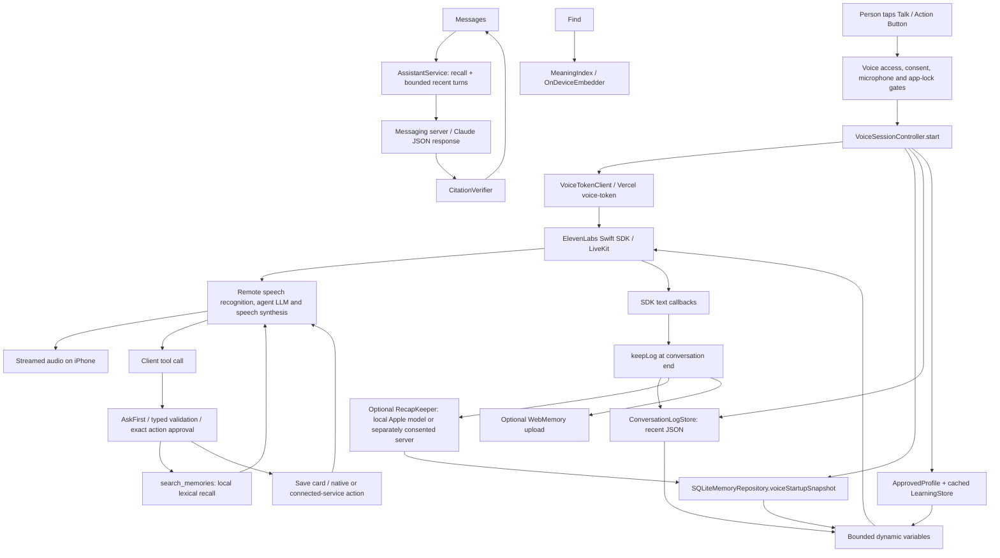

# DODDY memory and retrieval: repository audit

Audit date: 10 November 2026 (Europe/Warsaw). Baseline: `7a651eb27a20e04cab6663e107726a161d9dd7d1`, fetched from `Bienos/doddy.2/main`. Development branch: `feat/intelligent-memory-foundation`. This is a source-code audit, followed by local tests; it does not certify the installed app, live agent, processors or production databases. Test evidence is maintained in [IMPLEMENTATION](DODDY-MEMORY-RAG-IMPLEMENTATION.md). Older architecture/status documents were used for navigation only.

Before delivery, `main` advanced to `b000ee19d83b8c345a4abf119d1b147fbefafd21` (#315). The development branch was rebased onto it successfully. Its changed paths were inspected: the audited memory/database/profile/recap/assistant/voice-controller implementations were unchanged. The app unit suite and affected CI groups were rerun after rebasing. Baseline performance measurements remain explicitly tied to `7a651eb`; they are not measurements of production.

## Finding

DODDY already has a substantial local memory foundation. It needs reliable selection, privacy and lifecycle connections before another retrieval framework. Local notes, reviewed profile fields, confirmed learned facts, procedures, recent voice transcripts and optional recaps are distinct stores with different consent and retention. There is already lexical RAG in Messages and tool-mediated recall in voice. There is also an on-device semantic index, connected to Find rather than the conversational assistant.

The local database and history file are installation-scoped, despite mandatory Doddy accounts. A second signed-in account on the same installation can inherit personal data. Account isolation is a release blocker for a multi-account personal-memory claim; adding vector search would not solve it.

## Real conversation flow

`VoiceSessionController.swift` is the active voice controller; `VoiceConfig.connectionMode` chooses a Debug direct-agent connection or a token-server connection. The token request runs concurrently with local startup context after consent and microphone checks (`start`, approximately lines 700–912). The provider owns speech recognition, agent turn construction, LLM streaming and synthesis. The iPhone streams audio through the SDK/LiveKit, displays text callbacks and executes allowed local tools. Ordinary voice is not the older on-device-STT → gateway → local-TTS architecture. Voice memos, Capture transcription and read-aloud are separate paths.

`ConversationConfig` passes bounded variables: up to 24 non-private notes, 30 list summaries, 6,000 note characters, 4,000 conversation characters, opt-in profile, confirmed learned context, personality and task context. Recent user lines are clipped at 400 characters and Doddy lines at 1,000; truncation is indicated. Token fetching has a 15-second URL request timeout. Connection fallback and recovery are in `connectElevenLabs` and `SessionRecovery`. Attempts and tool-call ownership reject results from ended sessions (`reply`, `callOwners.finish`). No new per-turn model router is needed to preserve this path.

The remote live prompt/model cannot be inferred from `voice-agent/session.json`. Open PR #313 reports configuration drift; it was not merged at the audited head. Its live measurements are third-party session observations, not a baseline measured by this audit. No live prompt, agent version or service settings were changed or called here.

Retained `GatewayAssistantClient`, `BackendAssistantClient` and OpenAI realtime domain types are not the active iPhone composition described above. Some comments still describe the older transient-only chat and gateway architecture. Likewise, the semantic Find implementation exists but is hidden by the shipping scope and is not connected to conversational voice recall. The two opt-in server memory copies have different consumers and consent; merging them is an architectural proposal, not a safe deletion of “duplicate classes.”

## What is stored, and how it is connected

| Information | Owning storage and code | Persistence / actual use |
|---|---|---|
| Explicit notes and lists | `SQLiteMemoryRepository`, `SQLiteListRepository`, `memories`, `list_items` | GRDB 7.9.0, one `Application Support/Memories/memories.sqlite`; saves and corrections read back inside a write transaction |
| Original/current note wording | `MemoryRecord.rawText/currentText`, `memory_corrections` | Original retained; FTS indexes current wording; edit history/export available |
| Approved personal profile | `SQLiteProfileRepository`, `profile_fields` | Six fields: name, help, style, language, humor, context; reviewed Save, revision comparison; voice only with sharing on |
| Learned facts | `SQLiteLearnedFactRepository`, `learned_facts`, revisions + FTS | Proposed/confirmed/rejected/retired, evidence digest, provenance, scope, expiry; confirmation required; cached confirmed subset reaches voice |
| Procedures and outcomes | `SQLiteProcedureRepository`, `procedures`; `SQLiteOutcomeEventRepository` | Rule detects repeated approved tool sequences; never grants permission to run them; housekeeping retires unused procedures |
| Recent voice conversations | `ConversationLogStore`, `Application Support/Conversations/recent.json` | Last 10; remembering defaults on; next voice startup receives a character-bounded tail; private sessions excluded; no general local history search tool |
| Recap notes | `RecapKeeper`, `OnDeviceRecapWriter`, `RecapPolicy`, `RecapLedger` | Separate switch defaults off; model summary becomes source `conversation_recap`; fallback to server requires another opt-in |
| Typed Messages | `SQLiteMessageThreadRepository`, `thread_messages` and attachment tables | Persistent local thread; `ThreadRules.history` supplies selected turns; `AssistantService` caps at six turns × 2,000 scalars |
| Semantic vectors | `MeaningIndex` actor; `OnDeviceEmbedder` uses `NLContextualEmbedding` | In-process cache, lazily generated; no vector table or external embedding API; Find only, feature availability checked |
| Optional web memory | `WebMemoryModel`; `backend/src/memory/{service,crypto,search,chat}.ts` | Separate authenticated account service; server-decryptable encryption at rest; opt-in notes/conversations; web chat lexical excerpts, bounded recent conversation window |
| Optional memory on calls | `MemoryCopySync`; messaging memory-copy routes | Another server copy, full replacement sync; filters private notes; independent consent and failure/retry state |
| Live connected knowledge | Native EventKit/device tools; backend connected-app tools | Fresh reads with permission/approval, not automatically durable truths; saved copies can become stale |

Database migrations at baseline run from `v1_memories` to `v22_thread_local_action`. No SwiftData or Core Data store is connected to the audited primary memory path. The composition root is `AppEnvironment.live`; it wires real SQLite adapters and `RepositoryRecallService`. A database-opening failure supplies unavailable adapters and recovery copy, without resetting data. GRDB async reads/writes run database work off the caller; view-state updates are on the main actor. Database creation/migration is still synchronous at environment construction.

## Retrieval and trust trace

* **Lexical lookup:** `SearchFolding` → `RecallMatching.terms` → FTS5 prefix/OR query and `bm25` → bounded newest-5,000 fallback scan for inflections, typos and spoken numbers → matched-term-count ranking → `RepositoryRecallService`. A fixed EN/PL synonym list helps some bilingual queries; it is not general multilingual understanding. No result means `.noMatch`.
* **Voice:** startup context is a recent slice, not query relevance. `search_memories` calls `store.recall`, with privacy filtering and newest-three fallback explicitly labelled as *not matching*. `save_memory` only proposes a card; the user's Save tap writes the note. Retrieval may be omitted by the remote agent; source code alone cannot prove it always searches when needed.
* **Messages:** `AssistantService.ask` searches when `includeNotes` is true, selects at most five full notes and 12,000 scalars, sends them with recent turns to `/v1/assistant/ask`. The responder's default is `claude-haiku-5-5`, configurable remotely. This endpoint returns a full JSON response, not incremental text streaming. Client retries have 500/1,500-ms backoffs; the server Anthropic client also permits one retry. Retries can multiply latency/cost, though request identifiers and server handling must be considered separately.
* **Grounding:** `CitationVerifier` validates cited IDs against notes sent; it does not establish that every factual assertion is entailed. A failed local search still permits a model call with a `notesSearchFailed` indication. The prompt asks for abstention, but the native service does not enforce it for all autobiographical questions.
* **Learning:** `FactProposer` reuses user sentences from SaveSuggestions, `SensitiveContentFilter` and `LearningPolicy` gate proposals, and exact text must be confirmed. Confidence values are heuristics, not calibrated probability. `LearningContextAssembler` exists for per-query use; the active Messages request carries notes and turns, not learned facts or the approved profile. Voice receives a cached startup subset, potentially missing relevant older facts.

## Evidence-backed defects and gaps

| Priority | Evidence at audited head | Effect / response |
|---|---|---|
| P0 | `AppEnvironment.databaseURL`, profile schema, `ConversationLogStore.defaultURL`, account sign-out code | Installation-wide data has no authenticated owner scope. Do not enable broader automatic recall or cloud syncing until an explicit migration/quarantine design passes account-switch tests. Not solved by this patch. |
| P0 | `RecapKeeper.recapConversation`: policy before model await; unconditional save afterward | Turning remembering off while generation runs can still create a durable recap. A focused consent-epoch recheck is safe to implement. Account-switch cancellation remains separate. |
| P1 | `SQLiteMemoryRepository.query` applies limit before `RepositoryRecallService` removes lists; `ShareableRecallService` removes private IDs after base limit | Eligible notes can be crowded out. Private words can also affect fuzzy-match suppression. Push note/privacy scope into SQL before both index and fallback limits. |
| P1 | `ShareableRecallService.recall`, voice/Siri inline filtering | Privacy state may be captured before an awaited read. Recheck after await and route all external recall through the shared adapter. Already transmitted startup context cannot be recalled from a provider. |
| P1 | `ConversationLogStore.append` mutates published logs before disk save; `load` treats decode failure as empty | Failed writes look available as remembered context for the current process; corrupt files look like no history. Commit/read-back first and expose load/write failure. |
| P1 | `MeaningIndex.search` awaits embedding before writing cache; `MemoryStore` writes do not invalidate it | Old vectors can remain after delete/edit; an in-flight search can repopulate a cleared cache. Add invalidation generation and wire actual note mutations. |
| P1 | Voice context bounded to recent notes/history; no queryable local conversation archive | Restaurant from last month cannot be guaranteed: it must survive as an explicit note/recap or optional remote archive. Do not claim unlimited episodic memory. |
| P1 | Recaps share category `.other` and textual provenance; no conversation→recap FK for voice | Deleting a source conversation does not cascade to its recap; independent controls and copies complicate erasure. Proposed source graph required before a unified “forget everything about X” claim. |
| P1 | Note correction history versus unrelated active facts | Corrections work within one record; no canonical subject/predicate, valid-time or cross-record supersession. Company A → B cannot safely be inferred as a global update. |
| P2 | Fallback query scans and maps up to 5,000 full rows; semantic search embeds on demand | CPU/RAM grows with corpus. Measure before optimizing; no evidence yet supports ANN infrastructure. |
| P2 | `ConversationLogStore` sync JSON I/O on `@MainActor`; recap tasks are unstructured | Potential stalls/loss on suspension; last-ten count does not bound bytes per conversation. Future async bounded journal/outbox should preserve current API semantics. |

Other data protection: local directory/file protection is `completeUntilFirstUserAuthentication`, rather than SQLCipher encryption or permanent access denial after relock. SQLite `secure_delete` and FTS segment compaction already exist. They do not erase processor histories, exported files, backups, active remote context, independent server copies, undo buffers or summaries. A broad “deleted everywhere” claim is unsupported. App lock and private IDs are installation-local controls. No real user data, provider key or microphone was used for this audit.

## Performance reality

Code already overlaps token fetching with startup storage reads and avoids loading full correction/media history on voice startup. New embeddings or another LLM classification call on each turn would add dependencies to that path. There is no controlled before/after time-to-first-audio measurement in this audit. Local synthetic storage timings are recorded separately; they are not iPhone voice timings. RAM, battery, provider token usage and real conversation cost remain unmeasured.

## Source navigation

Paths above are relative to the audited repository. Immutable baseline can be inspected at [commit 7a651eb](https://github.com/Bienos/doddy.2/tree/7a651eb27a20e04cab6663e107726a161d9dd7d1). Principal entry points: `DoddyApp/Features/Voice/VoiceSessionController.swift` (`start`, `keepLog`, search tool, `reply`); `DoddyApp/Infrastructure/AppEnvironment.swift` (`live`, `databaseURL`); `Packages/DoddyCore/Sources/DoddyPersistence/DoddyDatabase.swift` (all migrations); `SQLiteMemoryRepository.swift` (`query`, `save`, `update`, `delete`); `DoddyCore/Search.swift`; `PrivateNotes.swift`; `MeaningSearch.swift`; `Assistant/AssistantService.swift`; `Learning/LearningService.swift`; `DoddyApp/Features/Recaps/RecapKeeper.swift`; `server/messaging/src/assistant/responder.ts`; `backend/src/memory/service.ts`. These were read as code, not inferred from feature names.

Selected immutable source anchors, verified against the baseline:

| Evidence | Source |
|---|---|
| Startup context and provider wiring | [VoiceSessionController:771](https://github.com/Bienos/doddy.2/blob/7a651eb27a20e04cab6663e107726a161d9dd7d1/DoddyApp/Features/Voice/VoiceSessionController.swift#L771) |
| End-of-session retention/recap | [VoiceSessionController:1268](https://github.com/Bienos/doddy.2/blob/7a651eb27a20e04cab6663e107726a161d9dd7d1/DoddyApp/Features/Voice/VoiceSessionController.swift#L1268) |
| Installation-scoped database | [AppEnvironment:145](https://github.com/Bienos/doddy.2/blob/7a651eb27a20e04cab6663e107726a161d9dd7d1/DoddyApp/Infrastructure/AppEnvironment.swift#L145) |
| Full-row search and limits | [SQLiteMemoryRepository:99](https://github.com/Bienos/doddy.2/blob/7a651eb27a20e04cab6663e107726a161d9dd7d1/Packages/DoddyCore/Sources/DoddyPersistence/SQLiteMemoryRepository.swift#L99) |
| Post-limit list filtering | [RepositoryRecallService:58](https://github.com/Bienos/doddy.2/blob/7a651eb27a20e04cab6663e107726a161d9dd7d1/Packages/DoddyCore/Sources/DoddyCore/Search.swift#L58) |
| Post-limit privacy filtering | [ShareableRecallService:62](https://github.com/Bienos/doddy.2/blob/7a651eb27a20e04cab6663e107726a161d9dd7d1/Packages/DoddyCore/Sources/DoddyCore/PrivateNotes.swift#L62) |
| Publication before file confirmation | [ConversationLogStore:31](https://github.com/Bienos/doddy.2/blob/7a651eb27a20e04cab6663e107726a161d9dd7d1/DoddyApp/Infrastructure/ConversationLogStore.swift#L31) |
| Awaited embedding/cache writes | [MeaningIndex:73](https://github.com/Bienos/doddy.2/blob/7a651eb27a20e04cab6663e107726a161d9dd7d1/Packages/DoddyCore/Sources/DoddyCore/MeaningSearch.swift#L73) |
| Recap consent before model await | [RecapKeeper:95](https://github.com/Bienos/doddy.2/blob/7a651eb27a20e04cab6663e107726a161d9dd7d1/DoddyApp/Features/Recaps/RecapKeeper.swift#L95) |
| Messages context and retries | [AssistantService:51](https://github.com/Bienos/doddy.2/blob/7a651eb27a20e04cab6663e107726a161d9dd7d1/Packages/DoddyCore/Sources/DoddyCore/Assistant/AssistantService.swift#L51) |
| Confirmed learned startup context | [LearningStore:243](https://github.com/Bienos/doddy.2/blob/7a651eb27a20e04cab6663e107726a161d9dd7d1/DoddyApp/Infrastructure/LearningStore.swift#L243) |
