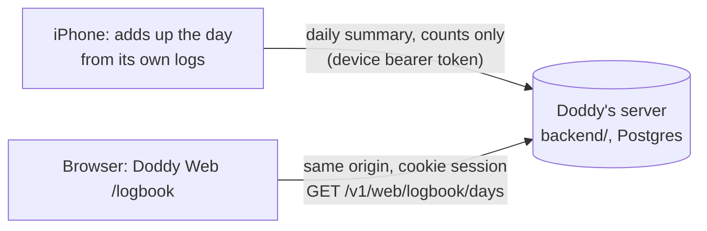

# Logbook: how you use Doddy, on the web

**Status: proposal, 22 Oct 2026 (ADR-593, proposed; ADR-594 for the design).** Logbook is a page in **Doddy Web**, the signed-in web app for the iPhone's account (`docs/platforms/web.md`; live at https://doddy-yaci.onrender.com once this branch is deployed there). **It shows example numbers only, and says so** in the menu and on the page: the page, its charts, its two languages and its tests are built (`web/src/pages/LogbookPage.tsx`, `web/src/logbook/`); the server tables and routes, the iPhone's daily counts and the paid gate are not. The first clickable mockup, kept as the design reference, is `design/web-logbook-v0.1/`. This page is the plan: what the page shows, where each number comes from, how the data gets there, what stays private, how it becomes paid later, and what the owner needs to decide.

## What the owner asked for

22 Oct, in the owner's words: "analytics for every people using Doddy… on a web app only… people would have to log into web app… very creative way of designing it, so it's engaging, easy to analyse… basic analytics and also more advanced analytics… 2 different tabs… accessible for now… then we're gonna make it a paid option… add to the website only."

Then, after a first version on the marketing site (doddy.lol): "not this web app, the one connected with iPhone app" (https://doddy-yaci.onrender.com), "the website's design". So Logbook lives in Doddy Web, which was restyled in the website's design (ADR-594), and was taken back out of doddy.lol.

## In short

**Logbook** is a signed-in page in Doddy Web (`/logbook`, "Dziennik" in Polish, in the menu with an Example marker). It has two tabs:

- **At a glance** (free, always): one week at a time, printed as a till receipt, plus what you used Doddy for, when you talked, the notes you saved and each day.
- **Closer look** (free while Doddy is in testing, part of a paid plan later): 7, 30 or 90 days of detail: every tool counted, when you talk by weekday and hour, how long conversations last and how they end, every yes and no, notes, lists, handed-over tasks, languages and the ways you open Doddy, with tables and a CSV download.

The numbers are **counts only**. Each iPhone adds up its own day, sends the totals once the person has turned Logbook on in the app, and the page reads them back. No note, word, name, place, email, event or audio ever leaves the phone for this page.

## The rules it keeps

| # | Rule | Where it comes from | How it's enforced (planned) |
|---|---|---|---|
| 1 | Counts, never content. Tool names come from Doddy's fixed tool list; everything else is a number. Tags, list names and the user's words are never sent. | DOD-11, ADR-011 ("content-free and separately controlled"), `AGENTS.md` ("no content telemetry") | The server accepts a day only if every key is on a fixed allow-list and every value is a whole number in range; anything else is refused with 400 (see "The daily summary"). Tests send words, unknown keys and floats and expect a refusal. |
| 2 | Off until the person turns it on in the app. Turning it off deletes what the server holds. | ADR-011, `doddy_rules.yaml` `user_revoke_access` | The app sends nothing while the switch is off (DoddyCore test). Switching off calls the delete route and shows "Deleted" only after the server confirms. |
| 3 | No streaks, scores, rankings, badges, "up 20% on last week" or nudges to talk more. | ADR-306 (the weekly look-back's rule), DOD-10, constitution: no guilt, no dependency, no exploitative commercial persuasion | Design rule. The page has no comparison fields to show; reviewed in the PR checklist. |
| 4 | Outcomes are honest: "Couldn't confirm" and "Didn't work" are counted and shown, never folded into "done". A no is the person's choice, shown in grey, not as a failure. | DOD-08, the constitution evidence rules ("unknown is never success") | The summary carries `done`, `declined`, `unsure`, `failed`, `undone` separately, straight from What Doddy did's statuses. |
| 5 | Doddy's handwriting never carries a number, an instruction or a state. | Brand guide (`docs/design/BRAND_GUIDELINES.md` §3) | Design rule. |
| 6 | Private notes are left out entirely, not even counted. | ADR-310 (private notes, behind Face ID) | The summary builder skips private note ids (DoddyCore test). |
| 7 | One person sees only their own Logbook. There is no admin view of anyone's Logbook. | `cross_user_isolation: required`, release gate `cross_user_data_leak` | Every read is keyed by the session's user id on the server; tests sign in as A and try to read B. |
| 8 | Paid later without pressure: At a glance stays complete and free; no blurred previews of the person's own numbers; "Not now" as large as "See plans"; no countdowns; nothing deleted for not paying; downloading and deleting everything stay free. | Constitution (no exploitative commercial persuasion), `docs/business/MONETIZATION_MODEL_V2.md` (paywall: "Not now is as prominent as Start trial"), `docs/product/V1_SCOPE.md` ("export and delete are never paywalled") | The locked state in the mockup (`png/04-…`). |

## What each tab shows

The mockup has every element below; the review strip's "Where each number comes from" switch shows each card's source.

### At a glance

- **Week selector** (‹ ›) over the last 13 weeks, and "This week so far". A line says when the iPhone last sent its counts.
- **The receipt.** Conversations, time talking, notes saved, list items added, things Doddy did (right away / after your yes), asked you first (you said yes / you said no), couldn't confirm, didn't work, tasks handed over. Footer: "Counts only. Your notes and words stay on your iPhone." Stamp: Counted.
- **What you used Doddy for.** Seven jobs, each a group of tools: Remember things, Plan the day, Lists, Find things out, Mail and messages, Hand things over, Translate. Hover or tap a row for the tools inside it.
- **When you talked.** One dot per conversation, by hour, then mornings, afternoons and evenings (and nights, if any).
- **Notes you saved.** One paper slip per note, grouped by the note types the app uses (Fact, Preference, Commitment, Recommendation, Decision, Item, Place, Intention, Other), and how they were saved (by voice, typed, shared, imported).
- **Each day.** Conversations a day; hover for the minutes.
- **What this page knows** (on both tabs): what's on it, what never is, and the controls.

### Closer look

- **Period:** 7, 30 or 90 days. **Show as tables** switches every chart to its table. **Download CSV.**
- **Totals:** conversations, time talking, average conversation, notes saved, things Doddy did. No arrows, no comparison with the period before.
- **Conversations** each day (each week at 90 days).
- **By weekday and hour:** a heatmap on graph paper.
- **How long they last** (under 1, 1 to 3, 3 to 5, 5 to 10 minutes; a conversation stops at 10) and **how they ended** (you ended it, Doddy wrapped up, went quiet, connection dropped).
- **Every tool, counted:** tool, app, times, done, you said no, couldn't confirm, didn't work, undone. Sortable.
- **When Doddy asked first:** asked, yes, no, and what happened after a yes.
- **Notes saved, by how** (stacked by voice, typed, shared, imported) **and by type.**
- **Tasks handed over** (count, finished, stopped, average time, web searches, pages read), **languages you talked in**, **how you opened Doddy** (app icon, Back Tap, Action Button, widget, Siri, Talk in the Island), **lists and translating**.

## Where each number comes from

"On the iPhone today" means the app already stores what's needed; it only has to add it up. "App update" means the app doesn't record it yet.

| Number | Today | What's needed |
|---|---|---|
| Things Doddy did, by tool and outcome; asked first, yes, no; couldn't confirm; didn't work; undone | On the iPhone: What Doddy did (`ActivityLog`, `ActivityLogStore`), 30 days or 300 entries, with each step's status (proposed, pending, confirmed, failed, unknown, declined) and undo | Add up each day before entries age out. Sums, unit conversions and the translator aren't logged there: an app update if wanted. |
| Notes saved, by how and by type | On the iPhone: the notes database (`capturedAt`, `source`, `category`) | Count by day, skipping private notes. Deleted notes can't be counted afterwards (deletion is a hard purge), so a day's count is fixed when it's sent. |
| List items added (voice or typed), ticked off | On the iPhone: `list_items` (`added_at`, `source`, `done_at`) | Count by day. |
| Tasks handed over, time, searches, pages read | On the iPhone (`errands`) and the messaging server (`errands`: searches, fetches, timestamps; content erased after the result is read) | Count by day from the iPhone's copy. |
| Conversations, time talking, by hour, length, how they ended | Partly: `connectedConversations` is a lifetime counter; `ConversationLog` keeps start, end and how it ended, but only for the last 10 and only when "Remember recent conversations" is on | **App update:** a content-free day counter in the voice controller (count, seconds, hour, length bucket, end reason). |
| Language of each conversation | Not recorded | **App update** (the conversation's language setting, or the language the agent switched to). |
| How you opened Doddy | Not recorded (`OpenDoddyWays` knows the ways, not the uses) | **App update:** count each start by Back Tap, Action Button, widget, Siri, the Island and the app icon. |
| Translator sessions and minutes | Deliberately not logged (`Translator.swift` writes nothing) | **Owner's call** (decision 4). Counts only, never the text. |

## The daily summary

What the iPhone sends for one local day. Integers only; tool names from the fixed list in `voice-agent/tools.json` / `ToolCatalog.swift`; language codes from the app's supported list. No free text anywhere.

```json
{
  "schema": "doddy.logbook.day.v1",
  "day": "2026-10-21",
  "conversations": {
    "count": 4, "seconds": 512,
    "by_hour": [0,0,0,0,0,0,0,0,1,0,0,0,0,1,0,0,0,0,0,0,0,2,0,0],
    "lengths": { "under_1": 1, "1_3": 2, "3_5": 1, "5_10": 0 },
    "ended": { "you": 2, "doddy": 1, "quiet": 1, "dropped": 0 },
    "languages": { "pl": 3, "en": 1 },
    "ways_in": { "app": 1, "back_tap": 2, "action_button": 0, "island": 0, "widget": 1, "siri": 0 }
  },
  "tools": {
    "get_weather": { "done": 2 },
    "create_reminder": { "done": 1, "declined": 1, "unsure": 0, "failed": 0, "undone": 0 }
  },
  "notes": { "by_source": { "voice": 1, "typed": 0, "shared": 0, "imported": 0 }, "by_kind": { "place": 1 }, "edited": 0 },
  "lists": { "added_voice": 3, "added_typed": 0, "ticked": 2 },
  "errands": { "handed_over": 0, "finished": 0, "stopped": 0, "minutes": 0, "searches": 0, "pages": 0 },
  "translator": { "sessions": 0, "minutes": 0 }
}
```

- **When it's sent:** the first time the app opens after midnight (for yesterday) and when it goes to the background (today so far, at most once an hour). The same day sent again replaces the earlier copy, so a retry never counts twice.
- **Server checks:** at most 4 KB; `schema` known; `day` within the last 2 days and not in the future (in the phone's own time zone); every key on the allow-list; every value a whole number from 0 to 10,000 (seconds up to 86,400, a day); `by_hour` exactly 24 numbers. Anything else: 400 and nothing stored.
- **Example data:** `web/src/logbook/exampleData.ts` generates 91 days in exactly this shape (seeded, so the same every time; a test pins the example week of 12 to 18 October).

## How it gets to the web



- **Store:** `backend/` (Render, Supabase Postgres schema `doddy_backend`), which already has the per-user rows and both sign-ins: the iPhone's device session (ADR-563) and the browser's cookie session (ADR-585). New table: `logbook_days` (user id, day, summary, received at; one row per user and day). Nothing new for sign-in: `web_links` and `web_sessions` exist.
- **Upload:** the iPhone sends one day at a time to a new route on the same server, with its own bearer token, through its existing server transport. The server validates against the allow-list (`web/src/logbook/schema.ts` is the same contract, written in zod, and a test checks every example day against it) and replaces that day's row.
- **Read:** new routes in `backend/src/web/routes.ts`, behind the same cookie session and CSRF checks as the other web routes: list days, delete all, export. The browser asks its own origin, so the page's security policy (`connect-src 'self'`) doesn't change. Replies get fixtures in `contracts/web/` like the others, read by the web and Swift tests.
- **The app** adds no analytics SDK, so the forbidden-capability guard's "no analytics SDKs" rule still holds; the guard should also gain a rule that the summary is built in one DoddyCore file and sent from one place.
- **In the web app today:** `useLogbookDays()` in `LogbookPage.tsx` returns the seeded example (`web/src/logbook/exampleData.ts`). It is the one function that changes when the server has real days, and `LogbookDays` in `schema.ts` is the shape its reply is checked against.

## Signing in

**Nothing new to build: Doddy Web signs in with a one-time code from the iPhone (ADR-585).** Settings › Doddy on the web on the phone gives eight letters and digits; the browser types them; the iPhone has vouched for it, and the browser gets an HttpOnly cookie session for the same server account. The phone lists every signed-in browser with Sign out. Logbook reads with that session and adds no sign-in of its own. (The first plan proposed a code the phone approves with a QR picture; Doddy Web already does the equivalent, so that proposal is dropped. Sign in with Apple or Google on the web, ADR-147 and ADR-526, stays a later way in.)

Limits to keep in mind: the device sign-in is "first device owns the server" while `DODDY_DEVICE_SIGNUP=first-device` (ADR-563), so today there is one account and Logbook is the owner's own; cross-user isolation (`doddy_rules.yaml` `cross_user_isolation`) must be tested before a second account can exist.

## Paid later

- **Now:** both tabs open. Closer look's tab says "Free while in testing". `docs/product/V1_SCOPE.md` §7 keeps the beta free with no paywall; the paid switch comes with the 1.0 pricing decision.
- **Then:** the backend returns Closer look's data only to accounts with the plan (the App Store subscription, checked on the server). Without it, the tab shows the locked state designed in `design/web-logbook-v0.1/png/04-closer-look-paid-later-1440.png` (not built in Doddy Web yet). Counting goes on either way and nothing is deleted. "Download everything" and "Delete everything here" stay on both tabs for everyone: export and delete are never paywalled (`V1_SCOPE.md`).
- **Which plan:** the owner's call. `MONETIZATION_MODEL_V2.md` proposes Best Mate, Doddy Crew and Doddy Pro.

## When something goes wrong

| Situation | What the page does |
|---|---|
| Logbook is off in the app | "Logbook is off. Turn it on in Doddy › Settings › Doddy on the web." Nothing is stored. |
| The iPhone hasn't sent anything for 2 days | "Your iPhone last sent counts on 18 Oct. Open Doddy to update." No guilt wording, no reminder pushes. |
| Today | Shown as "so far", with the time it was sent. |
| The server can't be reached | The last numbers stay on screen, dimmed, with "Couldn't load. Try again." Never a blank page or zeros. |
| An upload fails on the phone | Retried later with the same day key; a day is replaced, never added twice. |
| The person deletes everything | Two taps, then the server deletes and returns how many days it removed; the page says "Deleted" only after that. |
| Signed out in the app, or the account is deleted | Every web session for that account ends and its days are deleted. |
| Travel across time zones | Days are the phone's local days, as it counted them. |

## Privacy

- **Stored:** one row of counts per day, for 90 days (recommended; decision 3), in the backend's Postgres. Confirm the Supabase project's region before launch, and only then let the page say where it is kept.
- **Personal even without words:** the hour-by-hour pattern shows when someone is awake and busy. Only that person can see it, and the page says what it holds.
- **Before launch:** `docs/legal/PRIVACY_POLICY_DRAFT.md` currently says the app has no analytics; it must describe Logbook (what, where, how long, how to delete) and get the legal review `doddy_rules.yaml` requires (`legal_review_required_before_launch`).
- **Not part of this:** any owner dashboard across all users. That would be a separate, aggregated and anonymous design with its own decision.

## Build plan

Each step is its own pull request, in this order.

1. **Design.** *Done:* this plan and the clickable mockup `design/web-logbook-v0.1/`.
2. **The page in Doddy Web.** *Done 22 Oct:* Doddy Web in the website's design (ADR-594) and Logbook with example numbers: both tabs, the receipt, every chart with a table twin and a tooltip on keyboard focus, Polish and English, light and dark; 56 unit tests and a Chromium end-to-end test under the backend's real security headers.
3. **Server** (`backend/`): `logbook_days`, the upload route (device bearer) with the allow-list checks, the cookie-session read, delete and export routes, `contracts/web/` fixtures. Tests: refused content and unknown keys, replace-not-add, A can't read B, delete leaves nothing. Runs on Linux.
4. **Web, real data:** `useLogbookDays()` reads the server; the empty state ("Logbook is off in the app"), "the iPhone hasn't sent anything for two days" and the error line; the Example banner and menu marker go; `LOGBOOK_ENABLED` stays true.
5. **App** (DoddyCore and Settings): the conversation day counter, the summary builder (from What Doddy did, notes, lists, errands; private notes skipped), the upload, and the Logbook switch and delete in Settings › Doddy on the web. DoddyCore tests on Linux; the app needs the hosted Mac build.
6. **Paid gate**, after the pricing decision.

Until step 4, set `LOGBOOK_ENABLED = false` in `web/src/logbook/config.ts` before anyone but the owner gets Doddy Web: the menu entry and the route go with that one line.

## Decisions for the owner

1. **Name.** "Logbook" ("Dziennik"), with tabs "At a glance" and "Closer look" ("W skrócie", "Z bliska")? (Alternatives: "Your Doddy", "My week".)
2. **Fonts.** The website sets headings in Bricolage Grotesque and Doddy's lines in Caveat, from Google Fonts. Doddy Web's security policy allows no outside fonts and `CLAUDE.md` keeps font files out of the repository, so Doddy Web uses the same stacks with system fallbacks (Avenir Next or Segoe UI for headings, Bradley Hand or Segoe Print for Doddy's lines). To match the website exactly: allow Google Fonts in the policy (this sends visitors' IP addresses to Google, on a signed-in page), or self-host the two families after a licence review.
3. **How long counts are kept.** 90 days (recommended: Closer look's longest period) or 12 months (a year view, a stronger paid feature, more to hold).
4. **Translator.** Count sessions and minutes (never text), or keep it logging nothing, as today.
5. **New counts in the app.** OK to record each conversation's language and the way Doddy was opened (counts only)?
6. **Paid.** Which plan includes Closer look, and from when (the beta is free).
7. **Deleted notes.** Keep them in past days' counts (recommended: counts aren't content and can't be traced to a note) or not count notes until they're a day old.
8. **The menu entry.** Logbook shows in Doddy Web's menu, marked Example, while the web app is only the owner's (recommended). Hide it (`LOGBOOK_ENABLED`) before anyone else gets Doddy Web, or leave it as a preview?

## Constitution evidence log

| Rule | Evidence today | Gap |
|---|---|---|
| DOD-11 observable privacy, ADR-011 content-free telemetry | The contract is code: `schema.ts` refuses unknown fields, words where numbers belong and out-of-range values (tested); the page says what it will and won't know. Off by default in the design. | The server's allow-list, the app's switch and deletion are not built or tested. Privacy policy not updated. |
| DOD-10 non-manipulative companionship | No streaks, scores, comparisons or nudges on the page (a test searches its text for them and for trend arrows); the locked state in the mockup shows no blurred personal numbers and an equal "Not now". | The locked state isn't in Doddy Web yet; review again when real copy and pricing exist. |
| DOD-08 verified status and receipts | Couldn't confirm and Didn't work are separate counts and lines on the receipt (tested: done + couldn't confirm + didn't work = your yes). | The mapping from `ActionStatus` to the summary isn't written or tested. |
| ASK-01 | The page reads and deletes counts only; it starts nothing. | None for this page. |
| Cross-user isolation | Every read keyed by the session's user id (planned). | Not built; tests planned in step 3. |

**Tests run:** in `web/` (22 Oct 2026, Node 22, jsdom and headless Chromium 1194): `npm run typecheck`; `npm test` 56 pass (31 new: the summary contract and its refusals, adding days up checked by hand and for internal agreement over every week and period, ISO weeks and weekdays, Polish and English formats, the page's receipt, week arrows, period buttons, sorting, table twins, tooltip on focus, two-tap delete); `npm run build`; `npm run e2e` 12 pass (the new Logbook test runs under the real backend's content security policy and fails on any console error). In `backend/`: `npm test` 327 pass (unchanged code). `tools/gen_web_assets.py --check` PASS. The Swift app was not touched. **Not run:** real Safari or an iPhone, VoiceOver, the deployed server.

**Claims to limit:** don't call Logbook finished, private by guarantee or "analytics for every user". Every number on the page is an example from a seeded generator; no iPhone sends anything and the server keeps nothing for it yet. The Polish is a first draft.
