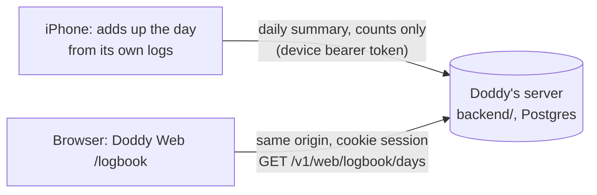

# Logbook: how you use Doddy, on the web

**Status: accepted by the owner 22 Oct 2026 ("go with recommendations", ADR-593; ADR-594 for the design). The web page and the server half are built; the iPhone half is not.** Logbook is a page in **Doddy Web**, the signed-in web app for the iPhone's account (`docs/platforms/web.md`; live at https://doddy-yaci.onrender.com once this branch is deployed there). Built: the page, its charts, its two languages (`web/src/pages/LogbookPage.tsx`, `web/src/logbook/`), and the server's tables and routes that keep, serve, export and delete a person's days (`backend/src/web/logbook.ts`, `routes.ts`, `store.ts`), with tests and fixtures. **Not built: the Doddy app on the iPhone** (the day counter, the summary builder, the upload and the switch in Settings), so **no iPhone sends anything today**, the page opens on "Logbook is off" and the only numbers anyone can look at are the example, shown on request and marked as made up. The paid gate is not built either. The first clickable mockup, kept as the design reference, is `design/web-logbook-v0.1/`. This page is the plan: what the page shows, where each number comes from, how the data gets there, what stays private, how it becomes paid later, and what was decided.

## What the owner asked for

22 Oct, in the owner's words: "analytics for every people using Doddy… on a web app only… people would have to log into web app… very creative way of designing it, so it's engaging, easy to analyse… basic analytics and also more advanced analytics… 2 different tabs… accessible for now… then we're gonna make it a paid option… add to the website only."

Then, after a first version on the marketing site (doddy.lol): "not this web app, the one connected with iPhone app" (https://doddy-yaci.onrender.com), "the website's design". So Logbook lives in Doddy Web, which was restyled in the website's design (ADR-594), and was taken back out of doddy.lol.

## In short

**Logbook** is a signed-in page in Doddy Web (`/logbook`, "Dziennik" in Polish, in the menu marked Example until the iPhone can send it). It has two tabs:

- **At a glance** (free, always): one week at a time, printed as a till receipt, plus what you used Doddy for, when you talked, the notes you saved and each day.
- **Closer look** (free while Doddy is in testing, part of a paid plan later): 7, 30 or 90 days of detail: every tool counted, when you talk by weekday and hour, how long conversations last and how they end, every yes and no, notes, lists, handed-over tasks, languages and the ways you open Doddy, with tables and a CSV download.

The numbers are **counts only**. Each iPhone adds up its own day, sends the totals once the person has turned Logbook on in the app, and the page reads them back. No note, word, name, place, email, event or audio ever leaves the phone for this page.

## The rules it keeps

| # | Rule | Where it comes from | How it's enforced (planned) |
|---|---|---|---|
| 1 | Counts, never content. Tool names come from Doddy's fixed tool list; everything else is a number. Tags, list names and the user's words are never sent. | DOD-11, ADR-011 ("content-free and separately controlled"), `AGENTS.md` ("no content telemetry") | The server accepts a day only if every key is on a fixed allow-list and every value is a whole number in range; anything else is refused with 400 (see "The daily summary"). Tests send words, unknown keys and floats and expect a refusal. |
| 2 | Off until the person turns it on in the app. Turning it off deletes what the server holds. | ADR-011, `doddy_rules.yaml` `user_revoke_access` | The app sends nothing while the switch is off (DoddyCore test). Switching off calls the delete route and shows "Deleted" only after the server confirms. |
| 3 | No streaks, scores, rankings, badges, "up 20% on last week" or nudges to talk more. | ADR-306 (the weekly look-back's rule), DOD-10, constitution: no guilt, no dependency, no exploitative commercial persuasion | Design rule. The page has no comparison fields to show; reviewed in the PR checklist. |
| 4 | Outcomes are honest: "Couldn't confirm" and "Didn't work" are counted and shown, never folded into "done". A no is the person's choice, shown in grey, not as a failure. | DOD-08, the constitution evidence rules ("unknown is never success") | The summary carries `done`, `declined`, `unsure`, `failed`, `undone` separately, straight from What Doddy did's statuses. |
| 5 | Doddy's handwriting never carries a number, an instruction or a state. | Brand guide (`docs/design/BRAND_GUIDELINES.md` §3) | Design rule. |
| 6 | Private notes are left out entirely, not even counted. | ADR-310 (private notes, behind Face ID) | The summary builder skips private note ids (DoddyCore test). |
| 7 | One person sees only their own Logbook. There is no admin view of anyone's Logbook. | `cross_user_isolation: required`, release gate `cross_user_data_leak` | Every read is keyed by the session's user id on the server; tests sign in as A and try to read B. |
| 8 | Paid later without pressure: At a glance stays complete and free; no blurred previews of the person's own numbers; "Not now" as large as "See plans"; no countdowns; nothing deleted for not paying; downloading and deleting everything stay free. | Constitution (no exploitative commercial persuasion), `docs/business/MONETIZATION_MODEL_V2.md` (paywall: "Not now is as prominent as Start trial"), `docs/product/V1_SCOPE.md` ("export and delete are never paywalled") | The locked state in the mockup (`png/04-…`). |

## What each tab shows

The mockup has every element below; the review strip's "Where each number comes from" switch shows each card's source.

### At a glance

- **Week selector** (‹ ›) over the weeks the iPhone has sent (the first may start mid-week), ending with "This week so far". It opens on the latest whole week, or on the week so far until there is one. A day the iPhone sent nothing for counts as nothing counted. A line says when the iPhone last sent its counts.
- **The receipt.** Conversations, time talking, notes saved, list items added, things Doddy did (right away / after your yes), asked you first (you said yes / you said no), couldn't confirm, didn't work, tasks handed over. Footer: "Counts only. Your notes and words stay on your iPhone." Stamp: Counted.
- **What you used Doddy for.** Seven jobs, each a group of tools: Remember things, Plan the day, Lists, Find things out, Mail and messages, Hand things over, Translate. Hover or tap a row for the tools inside it.
- **When you talked.** One dot per conversation, by hour, then mornings, afternoons and evenings (and nights, if any).
- **Notes you saved.** One paper slip per note, grouped by the note types the app uses (Fact, Preference, Commitment, Recommendation, Decision, Item, Place, Intention, Other), and how they were saved (by voice, typed, shared, imported).
- **Each day.** Conversations a day; hover for the minutes.
- **What this page knows** (on both tabs): what's on it, what never is, and the controls.

### Closer look

- **Period:** 7, 30 or 90 days. **Show as tables** switches every chart to its table. **Download CSV.**
- **Totals:** conversations, time talking, average conversation, notes saved, things Doddy did. No arrows, no comparison with the period before.
- **Conversations** each day (each week at 90 days).
- **By weekday and hour:** a heatmap on graph paper.
- **How long they last** (under 1, 1 to 3, 3 to 5, 5 to 10 minutes; a conversation stops at 10) and **how they ended** (you ended it, Doddy wrapped up, went quiet, connection dropped).
- **Every tool, counted:** tool, app, times, done, you said no, couldn't confirm, didn't work, undone. Sortable.
- **When Doddy asked first:** asked, yes, no, and what happened after a yes.
- **Notes saved, by how** (stacked by voice, typed, shared, imported) **and by type.**
- **Tasks handed over** (count, finished, stopped, average time, web searches, pages read), **languages you talked in**, **how you opened Doddy** (app icon, Back Tap, Action Button, widget, Siri, Talk in the Island), **lists and translating**.

## Where each number comes from

"On the iPhone today" means the app already stores what's needed; it only has to add it up. "App update" means the app doesn't record it yet.

| Number | Today | What's needed |
|---|---|---|
| Things Doddy did, by tool and outcome; asked first, yes, no; couldn't confirm; didn't work; undone | On the iPhone: What Doddy did (`ActivityLog`, `ActivityLogStore`), 30 days or 300 entries, with each step's status (proposed, pending, confirmed, failed, unknown, declined) and undo | Add up each day before entries age out. Sums, unit conversions and the translator aren't logged there: an app update if wanted. |
| Notes saved, by how and by type | On the iPhone: the notes database (`capturedAt`, `source`, `category`) | Count by day, skipping private notes. Deleted notes can't be counted afterwards (deletion is a hard purge), so a day's count is fixed when it's sent. |
| List items added (voice or typed), ticked off | On the iPhone: `list_items` (`added_at`, `source`, `done_at`) | Count by day. |
| Tasks handed over, time, searches, pages read | On the iPhone (`errands`) and the messaging server (`errands`: searches, fetches, timestamps; content erased after the result is read) | Count by day from the iPhone's copy. |
| Conversations, time talking, by hour, length, how they ended | Partly: `connectedConversations` is a lifetime counter; `ConversationLog` keeps start, end and how it ended, but only for the last 10 and only when "Remember recent conversations" is on | **App update:** a content-free day counter in the voice controller (count, seconds, hour, length bucket, end reason). |
| Language of each conversation | Not recorded | **App update** (the conversation's language setting, or the language the agent switched to). |
| How you opened Doddy | Not recorded (`OpenDoddyWays` knows the ways, not the uses) | **App update:** count each start by Back Tap, Action Button, widget, Siri, the Island and the app icon. |
| Translator sessions and minutes | Deliberately not logged (`Translator.swift` writes nothing) | **Owner's call** (decision 4). Counts only, never the text. |

## The daily summary

What the iPhone sends for one local day. Integers only; tool names from the fixed list in `voice-agent/tools.json` / `ToolCatalog.swift`; language codes from the app's supported list. No free text anywhere.

```json
{
  "schema": "doddy.logbook.day.v1",
  "day": "2026-10-21",
  "conversations": {
    "count": 4, "seconds": 512,
    "by_hour": [0,0,0,0,0,0,0,0,1,0,0,0,0,1,0,0,0,0,0,0,0,2,0,0],
    "lengths": { "under_1": 1, "1_3": 2, "3_5": 1, "5_10": 0 },
    "ended": { "you": 2, "doddy": 1, "quiet": 1, "dropped": 0 },
    "languages": { "pl": 3, "en": 1 },
    "ways_in": { "app": 1, "back_tap": 2, "action_button": 0, "island": 0, "widget": 1, "siri": 0 }
  },
  "tools": {
    "get_weather": { "done": 2 },
    "create_reminder": { "done": 1, "declined": 1, "unsure": 0, "failed": 0, "undone": 0 }
  },
  "notes": { "by_source": { "voice": 1, "typed": 0, "shared": 0, "imported": 0 }, "by_kind": { "place": 1 }, "edited": 0 },
  "lists": { "added_voice": 3, "added_typed": 0, "ticked": 2 },
  "errands": { "handed_over": 0, "finished": 0, "stopped": 0, "minutes": 0, "searches": 0, "pages": 0 },
  "translator": { "sessions": 0, "minutes": 0 }
}
```

- **When it's sent (planned, not built):** the first time the app opens after midnight (for yesterday) and when it goes to the background (today so far, at most once an hour). The same day sent again replaces the earlier copy, so a retry never counts twice.
- **Server checks (built, `backend/src/web/logbook.ts`, tested):** at most 16 KiB (a day with all 94 tools in use is about 7 KB); `schema` is `doddy.logbook.day.v1`; `day` is a real calendar day, the one in the address, inside the kept 90 days and no later than tomorrow (a phone east of UTC is already on the next date); every object strict; tool ids only from the voice agent's 94 (a test compares the list with `voice-agent/tools.json`); note types only the nine; languages only short codes, at most 12; every value a whole number from 0 to 10,000 (seconds up to 86,400); `by_hour` exactly 24 numbers; and the sums must agree (hours, lengths and endings add up to the conversations; languages and ways in don't exceed them; errands finished plus stopped don't exceed handed over). Anything else: 400, naming only the section and never a value, and nothing stored. Off for that person: 403 and nothing stored.
- **Example data:** `web/src/logbook/exampleData.ts` generates 91 days in exactly this shape (seeded, so the same every time; a test pins the example week of 12 to 18 October).

## How it gets to the web



- **Store (built):** `backend/` (Render, Supabase Postgres schema `doddy_backend`), which already has the per-user rows and both sign-ins: the iPhone's device session (ADR-563) and the browser's cookie session (ADR-585). Two new tables, created by the same idempotent schema: `logbook_state` (one row per person: on or off) and `logbook_days` (user id, day, the summary as JSON text, received at; one row per user and day). Nothing new for sign-in: `web_links` and `web_sessions` exist. An hourly sweep deletes days older than 90; reads also ignore them before the sweep runs.
- **The routes (built, `backend/src/web/routes.ts`; the iPhone's use of them is not):**

  | Route | Who | What |
  |---|---|---|
  | `PUT /v1/web/logbook/state` `{enabled}` | the iPhone only (device bearer) | Turns Logbook on or off for that person. Off deletes every stored day in the same transaction and says how many. |
  | `PUT /v1/web/logbook/days/:day` | the iPhone only; own body limit of 16 KiB | Validates the day against the allow-list and replaces that day's row. 403 `capability_disabled` ("Logbook is off for this iPhone… Nothing was stored.") while it's off. |
  | `GET /v1/web/logbook` | the browser's cookie or the iPhone | `{enabled, keptDays, updatedAt, days}`, oldest first. A stored row that no longer reads is left out, never shown half-read. |
  | `GET /v1/web/logbook/export` | the browser or the iPhone | The same as a JSON file download (`doddy-logbook-YYYY-MM-DD.json`) with the time it was made. |
  | `DELETE /v1/web/logbook` | the browser (the web app's own request header and origin) or the iPhone | Deletes every stored day, says how many. Logbook stays on or off as it was. |

  A browser can read, download and delete but never write: its cookie is refused on the two `PUT`s, so a page can't switch Logbook on or invent days. A guest iPhone (Ask Doddy only, ADR-587) has no Logbook. Every query is keyed by the caller's user id; tests sign in as A and read, delete and export B's.
- **Contract copies:** `backend/src/web/logbook.ts` (the allow-list, in zod) and `web/src/logbook/schema.ts` (the page's reading of it) are two copies. `contracts/web/logbook-*.json` and `error-logbook-*.json` are written from the real server (`npm run fixtures:web`) and the web tests read them through the page's schema.
- **The app** adds no analytics SDK, so the forbidden-capability guard's "no analytics SDKs" rule still holds; the guard should also gain a rule that the summary is built in one DoddyCore file and sent from one place.
- **In the web app today:** `LogbookPage` reads `GET /v1/web/logbook` (`api.logbook`, checked against `LogbookView` in `schema.ts`). Download everything and Delete everything here call the export and delete routes and say "Saved" or "Deleted" only after the server answers. Download CSV is built in the browser from the numbers shown (`web/src/logbook/csv.ts`: one row per day, English column names, numbers and dates only). The seeded example (`web/src/logbook/exampleData.ts`) is shown only when the person asks for it and is marked "Example".
- **One flag for the iPhone half:** `IPHONE_SENDS_LOGBOOK` in `web/src/logbook/config.ts` is `false` until the iPhone can send days. While it is false the page never tells anyone to switch Logbook on in the app (that switch doesn't exist yet), says the iPhone can't send it yet, and the menu keeps its Example marker. Flip it in the same change that ships the iPhone half; a test covers the true case.

## Signing in

**Nothing new to build: Doddy Web signs in with a one-time code from the iPhone (ADR-585).** Settings › Doddy on the web on the phone gives eight letters and digits; the browser types them; the iPhone has vouched for it, and the browser gets an HttpOnly cookie session for the same server account. The phone lists every signed-in browser with Sign out. Logbook reads with that session and adds no sign-in of its own. (The first plan proposed a code the phone approves with a QR picture; Doddy Web already does the equivalent, so that proposal is dropped. Sign in with Apple or Google on the web, ADR-147 and ADR-526, stays a later way in.)

Limits to keep in mind: the device sign-in is "first device owns the server" while `DODDY_DEVICE_SIGNUP=first-device` (ADR-563), so today there is one account and Logbook is the owner's own; cross-user isolation (`doddy_rules.yaml` `cross_user_isolation`) must be tested before a second account can exist.

## Paid later

- **Now:** both tabs open. Closer look's tab says "Free while in testing". `docs/product/V1_SCOPE.md` §7 keeps the beta free with no paywall; the paid switch comes with the 1.0 pricing decision.
- **Then:** the backend returns Closer look's data only to accounts with the plan (the App Store subscription, checked on the server). Without it, the tab shows the locked state designed in `design/web-logbook-v0.1/png/04-closer-look-paid-later-1440.png` (not built in Doddy Web yet). Counting goes on either way and nothing is deleted. "Download everything" and "Delete everything here" stay on both tabs for everyone: export and delete are never paywalled (`V1_SCOPE.md`).
- **Which plan:** the owner's call. `MONETIZATION_MODEL_V2.md` proposes Best Mate, Doddy Crew and Doddy Pro.

## When something goes wrong

| Situation | What the page does |
|---|---|
| Logbook is off | One calm card, "Logbook is off", and "Show an example". Once the iPhone half ships: "Turn it on in Doddy on your iPhone: Settings › Doddy on the web." Until then: "Your iPhone can't send Logbook yet: that part of the Doddy app isn't built." Nothing is stored. *(Built.)* |
| On, nothing sent yet | "Nothing counted yet. Logbook is on. The first days appear here after your iPhone sends them." No zeros, no empty charts. *(Built.)* |
| The iPhone hasn't sent anything for 2 days | "Your iPhone last sent counts on 18 Oct. Open Doddy to update." No guilt wording, no reminder pushes. *(Built; the "Open Doddy to update" wording is true only once the iPhone half exists.)* |
| Today | Shown as "so far", with the time the iPhone last sent. *(Built.)* |
| The server can't be reached | With nothing loaded: the error and "Try again", never zeros. With numbers already on screen (after a delete, say): they stay, dimmed, under the error. *(Built.)* |
| A reply the page can't read (a field the contract doesn't have) | An error, "The server sent something this page can't read", and nothing shown. *(Built.)* |
| A day the iPhone sent nothing for | Counts as nothing counted: weeks, periods and charts stay calendar-true. *(Built.)* |
| An upload fails on the phone | Retried later with the same day key; a day is replaced, never added twice. |
| The person deletes everything | Two taps, then the server deletes and returns how many days it removed; the page says "Deleted" only after that. |
| Signed out in the app, or the account is deleted | Every web session for that account ends and its days are deleted. |
| Travel across time zones | Days are the phone's local days, as it counted them. |

## Privacy

- **Stored:** one row of counts per day, for 90 days (recommended; decision 3), in the backend's Postgres. Confirm the Supabase project's region before launch, and only then let the page say where it is kept.
- **Personal even without words:** the hour-by-hour pattern shows when someone is awake and busy. Only that person can see it, and the page says what it holds.
- **Before launch:** `docs/legal/PRIVACY_POLICY_DRAFT.md` currently says the app has no analytics; it must describe Logbook (what, where, how long, how to delete) and get the legal review `doddy_rules.yaml` requires (`legal_review_required_before_launch`).
- **Not part of this:** any owner dashboard across all users. That would be a separate, aggregated and anonymous design with its own decision.

## Build plan

Each step is its own pull request, in this order.

1. **Design.** *Done:* this plan and the clickable mockup `design/web-logbook-v0.1/`.
2. **The page in Doddy Web.** *Done 22 Oct:* Doddy Web in the website's design (ADR-594) and Logbook with example numbers: both tabs, the receipt, every chart with a table twin and a tooltip on keyboard focus, Polish and English, light and dark; 56 unit tests and a Chromium end-to-end test under the backend's real security headers.
3. **Server** (`backend/`). *Done 22 Oct:* `logbook_state` and `logbook_days`, the upload route (device bearer) with the allow-list checks, the state, read, delete and export routes, the 90-day sweep, `contracts/web/logbook-*.json` fixtures, 37 tests (see the evidence log). Not deployed.
4. **Web, real data.** *Done 22 Oct:* the page reads the server; off, empty, error, unreadable-reply and "nothing for two days" states; the example only on request, with its banner; real Download everything, Delete everything here and CSV; calendar-true weeks. The menu's Example marker stays until the iPhone half ships (`IPHONE_SENDS_LOGBOOK`); `LOGBOOK_ENABLED` stays true.
5. **App** (DoddyCore and Settings). **NOT BUILT, and not buildable in the sessions so far (no Swift toolchain, so nothing here could be compiled or tested):** the conversation day counter, the summary builder (from What Doddy did, notes, lists, errands; private notes skipped; the language and way-in counters decided on 22 Oct), the upload to the routes above, and the Logbook switch and delete in Settings › Doddy on the web. DoddyCore tests on Linux; the app needs the hosted Mac build. Until it exists, no person has Logbook numbers.
6. **Paid gate**, after the pricing decision.

Until step 5 ships, set `LOGBOOK_ENABLED = false` in `web/src/logbook/config.ts` before anyone but the owner gets Doddy Web, unless the owner wants others to see the off card and the example: the menu entry and the route go with that one line. The server's routes are live whenever Doddy Web is (they refuse writes from anything but a signed-in iPhone).

## Decisions (owner, 22 Oct 2026: "go with recommendations")

The owner accepted every recommendation:

1. **Name.** Logbook ("Dziennik"), tabs "At a glance" and "Closer look" ("W skrócie", "Z bliska").
2. **Fonts.** Keep the system-font fallbacks. No Google Fonts in the security policy, no font files in the repository. (Matching the website's Bricolage Grotesque and Caveat exactly would need a licence review and self-hosting, or an outside request on a signed-in page.)
3. **How long counts are kept.** 90 days (Closer look's longest period). Enforced in code: the sweep, and reads that ignore older days.
4. **Translator.** Count sessions and minutes, never the text. (The counter is part of the iPhone half, not built.)
5. **New counts in the app.** OK to record each conversation's language and the way Doddy was opened, counts only. (Also the iPhone half.)
6. **Paid.** Closer look stays "free while in testing". Which plan includes it is decided at 1.0 (the beta is free, `V1_SCOPE.md` §7).
7. **Deleted notes.** Stay in past days' counts: a count isn't content and can't be traced to a note.
8. **The menu entry.** Logbook stays in Doddy Web's menu, marked Example, while the web app is only the owner's. `LOGBOOK_ENABLED` hides it before anyone else gets Doddy Web. (Now the marker follows `IPHONE_SENDS_LOGBOOK`: it stays until the iPhone can send days.)

Still the owner's: which plan Closer look belongs to, and when the paid gate starts (step 6); the Supabase region for the privacy policy; legal review of the privacy policy before launch.

## Constitution evidence log

| Rule | Evidence today | Gap |
|---|---|---|
| DOD-11 observable privacy, ADR-011 content-free telemetry | The contract is code in two places: `backend/src/web/logbook.ts` refuses unknown fields, unknown tool ids, words where numbers belong, out-of-range values and sums that don't add up; `web/src/logbook/schema.ts` refuses the same on the way back. Tests send a transcript field, a made-up tool name, words as a language, text and negative and fractional numbers, hours that don't add up, a wrong schema name and a day that isn't a calendar day, and expect 400 with nothing stored; a planted string never appears in the reply or the logs. The page says what it will and won't know. Off by default: the server refuses days until the iPhone turns Logbook on and deletes them when it turns it off (tested). | The iPhone's switch, its summary builder and its deletion are not built or tested. Privacy policy not updated. Region of the database not confirmed. |
| DOD-10 non-manipulative companionship | No streaks, scores, comparisons or nudges on the page (a test searches its text for them and for trend arrows); the off and empty states have no guilt wording and no reminders; the locked state in the mockup shows no blurred personal numbers and an equal "Not now". | The locked state isn't in Doddy Web yet; review again when real copy and pricing exist. |
| DOD-08 verified status and receipts | Couldn't confirm and Didn't work are separate counts and lines on the receipt (tested: done + couldn't confirm + didn't work = your yes). "Saved" and "Deleted" are said only after the server's answer (tested, including a refused delete that leaves the numbers). | The mapping from `ActionStatus` to the summary isn't written or tested (iPhone half). |
| ASK-01 | The page reads, downloads and deletes counts only; it starts nothing. The server's write routes accept the iPhone's own session only. | None for this page. |
| Cross-user isolation | Every query is keyed by the caller's user id; tests read, delete and export as B while A has days (and off for A leaves B's days). | Run again before a second account can exist (`DODDY_DEVICE_SIGNUP=first-device` means one account today). |

**Tests run** (22 Oct 2026, Node 22, jsdom and headless Chromium 1194 via Playwright 1.56.1):

- `backend/`: `npm test` **364 pass, 0 fail** (37 are new, `test/logbook.test.ts`: off by default; browser can't write; state takes one boolean; send, read, replace-not-add; the phone and the browser read the same view; canonical stored form; a full 94-tool day above the usual 8 KiB limit and below Logbook's 16 KiB; larger refused 413 and the state route keeps 8 KiB; 17 refused summaries; refusal names the section never the value; day in the address; kept-window edges; off deletes in the same step; browser delete needs the web app's own request; export; retention before and after the sweep; corrupt rows skipped; guests refused; the tool ids equal `voice-agent/tools.json`). `npm run fixtures:web` wrote `contracts/web/logbook-*.json` and `error-logbook-*.json`.
- `web/`: `npm run typecheck`; `npm test` **76 pass** (the page's states and real numbers; CSV; download; delete with two taps and a refusal; Polish; gap filling; the default week; the flag-on case; fixtures read through the page's schema); `npm run build`; `npm run e2e` **14 pass, 4 skipped** (the screenshot specs, which were then run on request and looked at, light and dark, desktop and phone size). The Logbook end-to-end tests run against the real backend under its content security policy and fail on any console error: off card, example on request, three days sent by the iPhone's own calls, a refused day, real receipt, JSON and CSV downloads, a cookie write refused with 401, two-tap delete.
- The Swift app was not touched. **Not run:** the iPhone half (nothing exists), real Safari or an iPhone, VoiceOver, the deployed server, Postgres itself (tests use PGlite, the same dialect).

**Claims to limit:** don't call Logbook finished, private by guarantee or "analytics for every user". No iPhone sends anything yet, so no real person has numbers on this page; the only numbers anyone can see are the seeded example, on request. The server half is tested against the contract here, not against a real phone's output or the production database. The Polish is a first draft.
