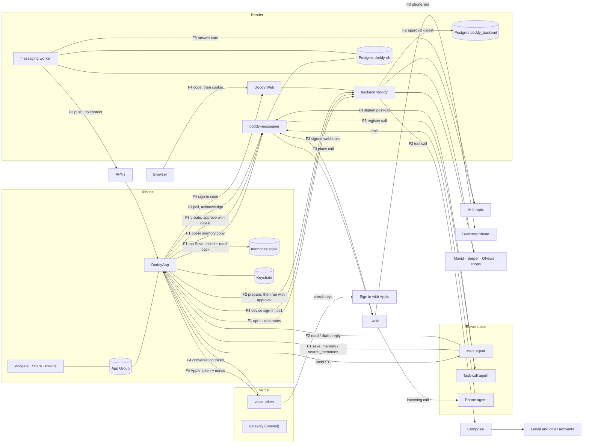

# How Doddy works (audit map, 1 Nov 2026)

Part of the research audit of 1 Nov 2026, read at commit `1a7dd21` on `claude/new-session-gz7pnp`. It describes the code as it is; it changes nothing. The improvement backlog is in `03_IMPROVEMENTS.md` next to this file. Security findings are kept out of the repository and went to the owner privately.

**How this was made:** by reading code, with `file:line` at every step. Nothing native was built or run (no Xcode in the audit environment), and no live service was contacted. Where a deployment fact comes from a comment and not from code, it says so. `render.yaml:13-17` says the Blueprint has not been applied and the live Render services were made by hand, so the live settings may differ from that file.

**Not mapped:** the Apple Watch and Mac apps (`DoddyWatch/`, `DoddyWatchWidgets/`, `DoddyMac/`, `DoddyMacWidgets/`) are paused (ADR-572).

## 1. The parts and where they run

| Part | Folder | Runs on | Entry points | How a caller proves who it is | What it stores, and where | Third parties |
|---|---|---|---|---|---|---|
| iPhone and iPad app | `DoddyApp/`, `Shared/`, `Packages/DoddyCore` (`DoddyCore`, `DoddyPersistence`) | The device | `doddy://` links (`Config/Doddy-Info.plist:70-80`, handled at `DoddyApp/App/RootView.swift:543-570`); the voice agent's tool calls (`DoddyApp/Features/Voice/VoiceSessionController.swift`); push and Live Activity updates (`DoddyApp/Infrastructure/Server/PushRegistrar.swift:67`); the return from connecting an online account (`DoddyApp/Features/ConnectedApps/SystemWebAuthenticator.swift`) | Nobody else calls in. An optional Face ID lock covers the app (`DoddyApp/Features/Privacy/AppLock.swift`). | SQLite through GRDB at `Application Support/Memories/memories.sqlite` (`DoddyApp/Infrastructure/AppEnvironment.swift:138-158`; migrations `v1_memories` to `v20` in `Packages/DoddyCore/Sources/DoddyPersistence/DoddyDatabase.swift`). Keychain for sign-in tokens. JSON files for recent conversations and the activity log. UserDefaults for settings. App Group files for widgets and the share extension. | ElevenLabs (the voice), OpenAI Realtime (the other voice), Doddy's own servers, Apple frameworks (EventKit, HealthKit, AlarmKit), InPost tracking |
| Widgets, controls, Live Activities | `DoddyWidgets/` | The device, as an extension | Home and Lock Screen widgets (`HomeWidgets.swift`); controls (`TalkToDoddyControl.swift`, `TalkInIslandControl.swift`, `NewNoteControl.swift`, `StartRecordingControl.swift`); Live Activities for voice, calls, recording, tools, alarms and shopping | Same App Group as the app | Reads a snapshot file the app writes (`Shared/Widgets/WidgetSnapshotFile.swift`) | none |
| Share extension | `DoddyShare/ShareViewController.swift` | The device, as an extension | "Save to Doddy" in the Share Sheet | Same App Group | One item in the share inbox (`Shared/Share/ShareInboxFile.swift`), which the app picks up and removes | none |
| App Intents and Siri | `DoddyApp/Intents/`, plus the Live Activity intents in `Shared/` | The device | Save, find, ask about a note, add to / read / tick a list, talk, stop listening, new note, record, timers, mute, end or take over a call | Apple's own unlock rules per intent | Through the app's stores | none |
| Backend and Doddy Web | `backend/src`, `web/` | Render web service `doddy` (Frankfurt, `render.yaml:19-31`) | The router in `backend/src/http.ts` (routes below); the browser app is served from the same origin (`backend/src/web/static.ts`) | iPhone: `Authorization: Bearer ds1.…`, checked by `SignedSessionVerifier` (`backend/src/auth.ts:86-105`). Browser: the `__Host-doddy_web` cookie (`backend/src/web/sessions.ts`). A Supabase verifier exists for Apple or Google sign-in (`auth.ts:163-227`) and is used only when `DODDY_AUTH_MODE=supabase`. | Postgres schema `doddy_backend` when `DATABASE_URL` is set, otherwise PGlite (`backend/src/db.ts`); tables in `backend/src/store.ts:68-226`. Kept notes and conversations are encrypted with AES-256-GCM (`backend/src/memory/crypto.ts`). | Composio for Gmail, Drive, Notion, Todoist, Outlook and Google Calendar (`backend/src/tools/composio.ts`); Anthropic (`backend/src/tools/claude.ts`, `backend/src/assist.ts`); Monid web search (`backend/src/tools/websearch.ts`) |
| Messaging, web part | `server/messaging/src` | Render web service `doddy-messaging` | Fastify routes (below) | iPhone: `Bearer <43-character random token>`, matched by its SHA-256 in `devices.token_hash` (`server/messaging/src/auth.ts:20-33`). Twilio: `X-Twilio-Signature`. ElevenLabs post-call: `ElevenLabs-Signature` HMAC (`taskCalls/elevenLabsSignature.ts`). Phone-agent tools: a shared tool secret plus a per-call session (`routes/elevenlabs.ts:31-46`). | Postgres `doddy-db`, migrations `server/messaging/migrations/001` to `014`. Message text, notes and call content are AES-256-GCM with each row's own associated data (`server/messaging/src/crypto.ts`). | Twilio (texts, Verify, voice), ElevenLabs, APNs (`providers/apns.ts`), Anthropic (Messages, errands, news, the call answer card), OpenAI (news fallback), GNews, Serper, shop and leaflet sites, RSS feeds |
| Messaging, worker | `server/messaging/src/worker.ts`, `workerLoop.ts` | Render worker `doddy-messaging-worker`, or inside the web process with `RUN_WORKER_IN_WEB=1` (`server/messaging/src/index.ts:31-41`) | Loops for the outbox, news digests, task calls, errands and price watches (`workerLoop.ts:33-46`) | n/a | Same Postgres | Same as above |
| Voice token server | `server/voice-token/` | Vercel project `doddy-voice-token` | `POST /api/voice-auth` (sign in, refresh, sign out, delete: `src/voice-auth.js`) and `POST /api/voice-token` (`src/handler.js`) | Sign in with Apple identity token at sign-in; after that a short HS256 access token (`iss doddy-voice`, `aud voice`) and a session lookup | Upstash Redis: sessions, hashed refresh tokens and nonces, the sealed Apple refresh token, rate counters | Apple (keys, token, revoke), ElevenLabs conversation tokens, OpenAI Realtime client secrets |
| Gateway | `gateway/` | Vercel `doddy-gateway`; not used by the app since ADR-587 | `POST /api/register`, `POST /api/assist` | Invite code, then a 24-hour signed token (`gateway/src/token.js`) | Upstash Redis counters | OpenAI Responses with `store: false` |
| Main voice agent | `voice-agent/instructions.md`, `tools.json`, `session.json` | ElevenLabs | 100 tools: 96 run on the phone (client tools) and 4 run on the web (open-meteo geocoding and weather, Wikipedia search and summary) | A conversation token from the voice token server | Conversation logs at ElevenLabs | n/a |
| Phone agent | `voice-agent/phone/` | ElevenLabs, behind Doddy's Twilio number | Server tools `verify_pin`, `search_memories`, `save_note`, plus call start | Tool secret plus a per-call session, then the caller's PIN | none of its own | n/a |
| Task-call agent | `voice-agent/task-call/` | ElevenLabs, "Doddy (calls for you)" | System tools `end_call` and `voicemail_detection` only | n/a | none; conversations are deleted after the result is built | n/a |

### Backend routes (`backend/src/http.ts` unless noted)
- **No session:** `GET /v1/health`; `GET /v1/oauth/return` and `/v1/oauth/verify` (they only redirect back to the app); `POST /v1/session/device`; `GET /v1/documents/:id?exp&sig` (a signed link, `backend/src/documents.ts`).
- **Any iPhone session:** `POST /v1/assist` (Ask Doddy).
- **Full iPhone session:** `GET /v1/connected-apps` and the Google Calendar routes; `GET /v1/tools`, `GET /v1/tools/receipts`, `PUT /v1/tools/switch`, `POST /v1/tools/prepare`, `POST /v1/tools/run`; `POST /v1/tools/:toolkit/(connect|complete|disconnect)`.
- **Doddy Web** (`backend/src/web/routes.ts`, `backend/src/memory/routes.ts`, `backend/src/messages/routes.ts`): sign-in codes and browser sessions, documents, Logbook, kept memory, chat, and the Messages copy. Each route says whether the phone, the browser, either, or anyone may call it (`web/routes.ts:243-262`). Everything else is the single-page app.

### Messaging routes (`server/messaging/src/routes/`)
- **Account:** `POST /v1/accounts`, `DELETE /v1/account`, push token (`account.ts`).
- **Phone number:** Verify start and check, read, delete, text consent, texting Doddy (`phone.ts`).
- **Updates (scheduled texts):** create, read, cancel (`updates.ts`).
- **Calls to and from the person:** settings, PIN, "call me", call list, call notes, memory copy for calls (`calls.ts`).
- **Call cases (calls Doddy makes for you):** availability, create, read, approve, end, take over, acknowledge, cancel, live lines, Live Activity (`callCases.ts`).
- **Errands and price watches:** create, approve, cancel, acknowledge, read, delete (`errands.ts`, `watches.ts`).
- **News, Messages and leaflets:** `news.ts`, `assistant.ts`, `deals.ts`.
- **Webhooks:** Twilio texts and status, Twilio task-call legs, ElevenLabs post-call, and the phone agent's call start and tools (`twilioWebhooks.ts`, `taskCallWebhooks.ts`, `elevenlabs.ts`).
- **Health:** `GET /healthz`.

## 2. Four flows, end to end

### Flow 1: "Remember that…" by voice, and recall later
1. The agent calls the client tool `save_memory {text}`. In `voice-agent/tools.json` it runs on the phone, with `confirm_on_screen: true` and `ask: tap`. Its description tells the agent never to say it is saved before the result comes back.
2. The app turns the call into `.saveMemory(text)` (`Packages/DoddyCore/Sources/DoddyCore/VoiceTools.swift:293-295`).
3. It shows a card and stores nothing yet (`VoiceSessionController.swift:2518-2523`: "Nothing is stored until the user taps Save on the card").
4. On Save, `confirmPendingAction` (`VoiceSessionController.swift:1299`, branch at 1310) first checks whether an earlier unconfirmed try already saved the same note (`NoteIdempotency.savedSince`, 1312-1317), then calls `store.save(…, source: .explicitVoice)` (1321).
5. **Where the save is verified:** `MemoryStore.save` (`DoddyApp/Infrastructure/MemoryStore.swift:103-111`) calls `SQLiteMemoryRepository.save` (`Packages/DoddyCore/Sources/DoddyPersistence/SQLiteMemoryRepository.swift:32-48`). It inserts the row, then reads it back in the same transaction and throws `verificationFailed` unless the stored row equals what was written (line 46). The island flash only follows a successful return (`VoiceSessionController.swift:1323-1327`).
6. What the agent hears back:
   - saved: `saved: one note (saved <time>). Its exact text:` plus the text as a data block (`VoiceTools.swift:767-770`, sent at `VoiceSessionController.swift:1332`);
   - failed: `failed: <reason> Nothing was saved.` (`VoiceTools.swift:772-774`, sent as an error at `VoiceSessionController.swift:1335`);
   - declined on the card: `declined: … Nothing was saved.` (`VoiceTools.swift:724`);
   - already saved by an earlier try: `noteAlreadySaved`.
7. Copies that leave the phone, each only when switched on, and never private notes:
   - **Memory on calls:** `PUT /v1/memory-copy/snapshot` replaces the whole copy on the messaging server (`DoddyCore/CallsClient.swift:182` → `server/messaging/src/routes/calls.ts:200-227`), encrypted per note, after `PUT /v1/memory-copy {enabled: true}`.
   - **Keep on Doddy's server:** `PUT /v1/web/memory/notes` on the backend (`DoddyCore/OnlineAccounts/WebMemoryClient.swift:184` → `backend/src/memory/routes.ts:58-62`), encrypted.
   - **Voice context:** when a conversation starts, the shareable notes go to ElevenLabs as the variable `saved_notes` (`VoiceSessionController.swift:738`, rendered by `VoiceContext.swift`).
   Both server copies run after each change of `store.revision` that reloaded cleanly (`RootView.swift:344-350`).
8. **Recall:** the agent calls `search_memories {query}` (`ask: yes_or_tap`, no card). A `#tag` query filters directly (`VoiceSessionController.swift:2505-2517`); otherwise `store.recall` (`MemoryStore.swift:213`) runs the FTS5 search (`DoddyCore/Search.swift:65-69`, `SQLiteMemoryRepository.query`), private notes are removed, and `VoiceToolReply.search` (`VoiceTools.swift:734-765`) answers with the exact texts, marks partial or conflicting matches, or says nothing matched and not to guess.
9. **On a phone call** (the phone agent): `search-memories` reads the memory copy after the PIN; `save-note` stores an encrypted call note and answers `saved_for_confirmation` (`server/messaging/src/routes/elevenlabs.ts:117-178`). The app lists call notes (`GET /v1/call-notes`), and a note reaches the phone's memory only when the person confirms it.

### Flow 2: "Reply to that email"
1. **`read_email {query}`** (phone, `ask: yes_or_tap`). The app calls `POST /v1/tools/prepare` (`DoddyCore/OnlineAccounts/OnlineAccountsClient.swift:88`). `CloudToolsService.prepare` (`backend/src/tools/service.ts:529-547`) builds a preview and issues an approval bound to the digest of the arguments: SHA-256 of canonical JSON (`backend/src/policy.ts:19`), kept in `approvals` (`store.ts:1098-1113`) for 120 seconds (`backend/src/tools/askFirst.ts:15`). After the person's yes, the app calls `POST /v1/tools/run` (`VoiceSessionController.swift:3170-3180`). The server uses up the approval, runs Gmail through Composio (`backend/src/tools/composio.ts:104-117`) and returns the text, which the app passes to the agent marked as information (`VoiceCloudTools.swift:19-23`).
2. **`draft_email_reply {query, body}`** (`backend/src/tools/catalog.ts:1068-1127`). `prepare` looks up the newest matching message: its sender, thread and subject (`service.ts:549-557`). The approval is bound to the digest of `{arguments, target}` (`service.ts:559-560,1090-1092`). The card shows `To:`, the subject and the body, with a "Create draft" button. A tap runs it (`VoiceSessionController.swift:1425-1429` → `3262-3268` → `CloudActions.swift:26-42`), retrying once with the same approval only if the answer was lost on the way. The result says the draft was not sent.
3. **`reply_to_email {query, body}`** (`catalog.ts:1197-1229`) works the same way with its own approval, so approving a draft never approves a send. The card says the reply can't be taken back, and `ask: tap` means a spoken yes is not enough.
4. **What an approval holds:** its id goes to the app; the server keeps the user, the tool, the connection, the argument digest, the expiry and when it was used (`store.ts:121-133`).
5. **Where "sent" is checked against "approved":** at run time the server looks the target up again right before the write (`service.ts:756`), recomputes the digest from the request's arguments and that target, and uses up the approval only if user, tool, connection and digest all match, it hasn't expired, and an atomic `UPDATE … WHERE consumed_at IS NULL` succeeds (`service.ts:765`, `store.ts:1116-1148`). The provider arguments are built from the same checked arguments and target (`catalog.ts:1211-1214`): the recipient and thread come from Gmail's lookup, not from the agent. A mismatch answers "This action needs a fresh confirmation" (`service.ts:731-736`).
6. **Outcome:** recorded as succeeded, failed, or `outcome_unknown` when a write was sent and its answer couldn't be read (`service.ts:690-705,781-797`). A second run with a used approval returns the first answer and sends nothing (`service.ts:610-641`). Writes are never retried by the server (`maxRetries: 0`).

### Flow 3: Doddy phones a business for the person (call cases), and errands
The main voice agent has no calling tool. Calls start in the app: Settings › Calls › Calls Doddy makes for you (`DoddyApp/Features/Calls/CallsSettingsView.swift:146`, brief form `CallBriefEditorView.swift`), through `DoddyCore/CallCasesClient.swift` with the messaging token.
1. **Availability:** `GET /v1/call-cases/availability` (`server/messaging/src/routes/callCases.ts:39-54`) reports the switch, the verified phone, calling hours and whether the live agent matches its spec.
2. **Create:** `POST /v1/call-cases` → `createCase` (`taskCalls/service.ts:78-121`) checks the brief (`brief.ts`), classifies the destination, requires the person's own phone verified by Twilio Verify, builds the payload (`payload.ts:57`), computes its digest (`payload.ts:118`), stores it encrypted and returns a preview with the digest.
3. **Approve exactly the card:** the app sends `POST /:id/approve {digest}` (`CallCasesModel.swift:281-285`); `approve` (`taskCalls/service.ts:128-176`) refuses a different digest, checks hours and attempts, and records the approved digest and device.
4. **Dial:** `dialAttempt` (`taskCalls/service.ts:181-263`) is the only code that asks Twilio to place a task call. Under one lock it checks the agent spec, decrypts the payload and compares it with the approved digest, checks the destination, the from-number and the limits, then calls Twilio with webhook URLs that carry the attempt id. A call whose result is unknown is never dialled again.
5. **Answer:** Twilio's signed answer webhook (`routes/taskCallWebhooks.ts`) runs `onAnswer` (`taskCalls/webhooks.ts:57-98`), which claims the answer once, re-checks the switch, hours, spec and payload digest and that the numbers match the approved payload, registers the call with ElevenLabs with the approved variables, and connects the call.
6. **During the call:** live lines arrive through Twilio transcription and are stored encrypted; the app polls `GET /:id/live`; the person can end the call or take over (`taskCalls/takeover.ts`), which rings their own verified phone.
7. **After the call:** Twilio's status webhook and ElevenLabs' signed post-call webhook (checked over the raw body) store the transcript encrypted and queue the conversation's deletion at ElevenLabs (`taskCalls/webhooks.ts:234-281`).
8. **Result:** the worker (`taskCalls/worker.ts:125-216`) builds the answer card (`taskCalls/result.ts`, optionally with a model-written summary from `taskCalls/writer.ts`), stores it encrypted with a digest and a 7-day expiry, deletes the live lines and sends a push with no content ("Doddy skończył rozmowę. Odpowiedź czeka w aplikacji.") through the outbox and APNs.
9. **In the app:** it polls the case, saves the answer card to SQLite first (`SQLiteCallCaseRepository`, migration `v14_call_cases`), then acknowledges it with the result digest (`CallCasesModel.swift:448-505`); the server checks the digest and deletes its copy (`taskCalls/cases.ts:106-127`). The answer shows on the case in Calls (`CallCaseView.swift`).
10. **Errands** (research, no phone call): the voice tool `hand_over_errand` creates an errand (`POST /v1/errands`) and approves it with its digest (`server/messaging/src/errands/service.ts:82-98`). The worker checks the digest again (`errands/worker.ts`), runs Claude with web search and fetch (`errands/researcher.ts`), stores the result encrypted and sends a push. **Tasks** in the app (`DoddyApp/Features/Errands/ErrandsView.swift`, from Home's menu) lists errands; the app acknowledges each result once it has it.

### Flow 4: Sign-in
Today there are four separate identities, not linked to one another.
1. **Voice (Sign in with Apple, voice token server):** the app sends Apple's identity token, the raw nonce and optionally an authorization code to `POST /api/voice-auth` (`DoddyApp/Features/Voice/VoiceAuthSession.swift:71-78`). The server checks Apple's signature, issuer, audience (the app's bundle id), expiry and nonce (`server/voice-token/src/voice-auth.js:355-375`), then issues a 10-minute access token that the app keeps in memory and a 30-day refresh token, rotated on use and stored hashed, that the app keeps in the Keychain. With the access token, `POST /api/voice-token` returns an ElevenLabs conversation token or an OpenAI Realtime client secret (`src/handler.js:105-129`), and the app starts the voice session with it.
2. **Backend (device sign-in, ADR-563):** the app makes a random device id and keeps it in the Keychain (`DoddyApp/Infrastructure/DeviceSession.swift:58-77`), and posts it to `POST /v1/session/device`. The server derives the user id from it with an HMAC (`backend/src/deviceSession.ts:133-139`) and returns a 30-day `ds1` token signed with HMAC-SHA256 (`backend/src/auth.ts:78-105`). A full session reaches every tool; a guest session reaches Ask Doddy only (ADR-563, ADR-587). The app keeps the token in the Keychain, bound to the server that issued it. Supabase sign-in with Apple or Google (ADR-526) is built on the server only; the app side isn't built (ADR-600). Google appears in the app only when **connecting an account** through Composio: `POST /v1/tools/:toolkit/connect` returns a link, the app opens it in `ASWebAuthenticationSession`, `/v1/oauth/return` sends the browser back to the app, and the app calls `…/complete`. Composio holds the Google tokens; the backend keeps the connection id.
3. **Messaging (anonymous):** `POST /v1/accounts` returns a 256-bit random device token; the server keeps only its SHA-256 (`server/messaging/src/routes/account.ts:21-33`, `auth.ts:13-33`). The app keeps it in the Keychain. A phone number is added separately through Twilio Verify.
4. **Doddy Web:** the iPhone asks for a one-time 8-character code (`POST /v1/web/link-codes`, valid 5 minutes, stored hashed). The person types it in the browser (`POST /v1/web/session`, same-origin checks), which gets the `__Host-doddy_web` cookie: HttpOnly, Secure, SameSite=Strict, 30 days or 14 days idle, stored hashed (`backend/src/web/sessions.ts`). The iPhone can list and sign out browser sessions.

## 3. Diagram

## 4. Data at rest
- **`memories.sqlite` (device):** notes and their versions, lists and items, photo and audio references, note reminders, learned facts, procedures, call cases and results, errands, recordings, the Messages thread, the training log. File protection until first unlock; `secure_delete` on (`AppEnvironment.swift:154-157`, `DoddyDatabase.swift`).
- **Keychain (device, this device only):** the device id, the backend `ds1` token (bound to its server), the messaging device token, the voice refresh token, the inFakt key.
- **App Group:** the widget snapshot; one share-inbox item at a time.
- **Application Support files:** recent conversations (`Conversations/recent.json`), the activity log (`activity.json`), photos and audio.
- **UserDefaults:** settings and switches, and the set of private-note ids.
- **Backend Postgres `doddy_backend` (or PGlite):** users and their Composio user ids, connections, attempts, receipts, usage counters, approvals (digests only), tool switches, documents (7 days), web sign-in codes and sessions (hashed), Logbook, kept notes and conversations (encrypted, 1 year), the Messages copy (encrypted). Sweeps run hourly (`backend/src/app.ts:146-170`).
- **Messaging Postgres `doddy-db`:** accounts and devices (token hash, APNs token), phone numbers and consents, outbound texts (body encrypted, erased once final), call settings (PIN hash), memory copies and call notes (encrypted), calls and call sessions, call cases and their attempts, live lines and results (encrypted; numbers kept as HMACs), errands (encrypted), price watches, news tables, usage counters, phone verification starts.
- **Upstash Redis (voice token server):** sessions, refresh-token and nonce hashes, the sealed Apple refresh token, rate counters.
- **Third parties:** Composio holds the OAuth grants for connected accounts; ElevenLabs keeps conversation logs for the main and phone agents (task-call conversations are deleted after the result is built); Twilio keeps call and text records.
