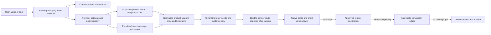

# DODDY
## Global affiliate and AI-shopping due diligence

**Research date:** 30 October 2026  
**Decision lens:** Poland first; expand only with local data rights and approved distribution.  
**Repository snapshot:** [Bienos/doddy.2, commit df33aa5aa93f914f9c7bfbe82d83f5d43fb186fd](https://github.com/Bienos/doddy.2/tree/df33aa5aa93f914f9c7bfbe82d83f5d43fb186fd).  
**Status:** Research and static code review. No application, contract, production configuration, build, device test or purchase was performed.

## 1. Executive decision

Proceed with a **Poland-only, permissioned shopping pilot** as a trust and product-learning feature. Do not budget for affiliate commissions as the primary funding source for the companion until measured results and signed terms demonstrate otherwise. Extend the existing shopping tool and result builder; do not introduce a separate autonomous agent to start.

The repository already contains a shopping search and a partner-link mechanism. It can construct a tracked link after recommendations have been selected, with empty configuration by default. That is a useful independence boundary. It is not proof that a live affiliate contract, a conversion ledger, approved product feeds, or reliable current stock data exist. Search and page-reading can provide evidence of a price under the code's rules, but do not by themselves create a licence to republish a merchant's product data.

The database contains **322 distinct publicly listed programmes**, including **296 entries whose stated market includes Poland**. Twenty-nine entries have a merchant or programme-operator source, and 293 have an official network programme page. All are **partially verified**: public listing or application availability was checked, while current enrolment, advertiser acceptance of DODDY, contract, tracking, app distribution, AI use and payout were not established. The 322 must not be presented as 322 active, DODDY-approved partners. Fifty-eight further opportunities were excluded rather than padded into the count. Mixed-category merchants remain subject to product-level exclusions. The research is broad but not an exhaustive census of global programmes.

Under the illustrative base case at 100,000 MAUs, the model estimates **2,296 zł net affiliate revenue per month** and **5,022 zł incremental shopping cost**. The wider model estimates 142,522 zł of monthly shopping, ordinary usage and hosting cost, producing **-140,226 zł affiliate-only contribution** before staffing, acquisition and overhead. A 29.99 zł gross subscription with 5% paid penetration improves the model, but the hybrid case remains **-82,449 zł** under these assumptions. These are not measurements or promises. Voice cost, shopping intent, conversion and attribution must be replaced with DODDY's data; the Excel workbook exposes all inputs.

### Recommended commercial sequence

1. **Allegro Affiliate direct:** apply as the actual business and describe the iPhone app, conversational recommendations, feed, voice and link flow. Use its approved feed only for the approved scope. Ask whether sending users directly to the Allegro app preserves credit. [Allegro Affiliate](https://allegro.pl/programy-lojalnosciowe/allegro-affiliate).
2. **Admitad:** apply to Decathlon and Carrefour for relevant physical categories; both public profiles list application traffic and feed/deeplink tools. Ask Media Expert and x-kom for an express publisher-type decision because their terms are more selective. [Decathlon](https://www.admitad.com/store/offers/decathlon-pl/), [Carrefour](https://www.admitad.com/store/offers/carrefour-pl/), [Media Expert](https://www.admitad.com/store/offers/mediaexpert-cps-pl/), [x-kom](https://www.admitad.com/pl/store/offers/x-kom-pl/).
3. **Tradedoubler and webePartners:** use network access to compare approved Polish publishers and feeds. Request a written decision on mobile conversational apps for each advertiser; public network tools do not extend merchant rights automatically. [Tradedoubler publisher API](https://dev.tradedoubler.com/products/publisher/), [webePartners tools](https://webepartners.pl/en/tools/).
4. **Skąpiec / Kelkoo / Sovrn:** request commercial and technical diligence on Poland coverage, product-level prices, licence and cost. Skąpiec publicly describes a free, approval-based beta API for prices, photos and reviews, but its current operational status and app/AI rights require confirmation. [Skąpiec API](https://www.skapiec.pl/nowe-api-skapiec), [Kelkoo](https://docs.kelkoogroup.com/for-publishers/publisher-center), [Sovrn](https://developer.sovrn.com/reference/get_product_recommendations).
5. Add non-partner options when data use is lawful. Rank for user fit and evidence, then attach approved affiliate links to the selected offers. Keep paid placements outside the organic ranking and label them separately if introduced.
6. Run a small pilot with a cost ceiling, documented verification and human complaint handling. Expand only after the target thresholds in section 10 are met. No merchant outreach or applications have been sent as part of this work.

## 2. Evidence method and limits

The master workbook and CSV contain the source URL, date, programme/merchant, geographic scope, commission and cookie where publicly established, app and AI status, product feed/API, payment, restrictions, next action and confidence. Unknown terms are explicitly marked unknown; a network feature is never treated as a merchant entitlement. One row represents one merchant programme or consolidated merchant route, not a separate count for every geography, sub-brand, website or tracking network.

The bulk Poland longlist was compiled from individually fetched public webePartners merchant pages, not from assumed store participation. Some pages may remain indexed even if a programme is paused or a particular publisher cannot join. Source grade A means the official merchant or operator page; B means the official network's merchant programme page. These grades reflect source authority, not operational readiness. A public invitation to join and HTTP success are not evidence of current conversions or a signed contract. Additional review is needed for merchant status, ad creative, tracking methods, category exclusions and tax treatment.

Among the 47 individually researched non-webe listings, a separate automated access check returned HTTP 200 for 37 official URLs and an access-blocking response for 10. For the blocked pages, evidence came from official material surfaced during web research; current browser access and complete terms should be rechecked. This is not evidence that a programme is closed. Per-row access notes are included in the master database.

The technical findings are a **scoped static review** of relevant app, backend, voice/tool and infrastructure files at the pinned commit. This is not a complete security audit, runtime inspection, review of every file in the repository, or proof of deployed settings. The current live website and production service configuration were not independently verified. A file's comments or configuration defaults do not prove the feature is enabled for users.

## 3. Programme diligence: Poland first

### Allegro

Direct Allegro Affiliate explicitly contemplates approved websites and mobile applications. Its page describes a business-account route, product feed, campaign-specific commission and a 24-hour direct attribution period. An active or VAT-exempt status and other eligibility requirements apply. The direct payout description involves validation after month end and invoicing. Categories are restricted; medicines, supplements and other excluded categories must be screened against the live rules. Obtain the terms for the actual property and data usage before launch. [Official programme](https://allegro.pl/programy-lojalnosciowe/allegro-affiliate).

An alternative Tradedoubler listing says mobile applications and price-comparison traffic are permitted, while recommending web/mobile web over redirecting to an app. **Its description states 24 hours but the same listing's summary says 30 days.** Treat the attribution window as unresolved until the network confirms the signed route. The 2026 rate card has category-specific percentages, caps and tiers: for example, electronics is shown at 0.93%, not the model's assumed 3.5% blended rate. Some supermarket categories carry different rates. [Tradedoubler listing](https://directory.tradedoubler.com/pl/programs/288386-Allegro-pl-PL), [2026 rate card](https://hst.tradedoubler.com/file/288386/prowizje_allegro_2026.pdf).

### Priority advertisers

- **Decathlon PL:** the programme profile lists applications, a product feed and deeplinks. Gift cards are excluded and some coupon-publisher terms differ. An app category on a public page is not approval of DODDY's particular AI flow.
- **Carrefour PL:** its profile lists mobile applications, price comparison, a feed and deeplinks, with restrictions on Google advertising. Establish product coverage and whether groceries or specific departments are commissionable.
- **x-kom:** the official network page describes selected-publisher admission, a 24-hour window and possible commission reductions when the user buys a different item, uses a discount code or receives a price reduction. Its retailer-app tracking conditions do not themselves establish permission for a publisher's app. Price-comparison plugins are restricted; explain DODDY's use and obtain a decision.
- **Media Expert:** the public listing restricts traffic types; other publisher types require contact. Current commercial rates were behind login during this review. Apply only after describing the flow.
- **RTV EURO AGD:** the merchant and Tradedoubler describe a partner route. Automatic bot opening of partner links is prohibited; initiate external navigation only through the user's deliberate action. [Merchant](https://www.euro.com.pl/cms/program-partnerski.bhtml).
- **Douglas, Answear and Anker CEE:** viable secondary categories, subject to restrictions. Douglas lists 30 days and prohibits cookie dropping and frames. Answear's Awin profile has channel and creative limitations. Anker's Webgains page displays 6% and up to 30 days; use the Polish destination and data rather than assuming a regional feed represents Polish stock. [Douglas](https://www.admitad.com/store/offers/douglas-pl/), [Answear](https://ui.awin.com/merchant-profile/8015), [Anker](https://www.webgains.com/front/publisher/program/view/programID/310660).

The database ranks opportunities for follow-up, not for recommendation placement. Large familiar merchants whose current official programme and suitable Polish app route were not established - including Morele, Notino PL, Zalando's ordinary retail route, IKEA, Lidl and Biedronka - remain **unknown**, not declared unavailable. Search outcomes and historical blog posts are not enough to add or exclude them conclusively.

### Wider networks and travel

Awin, CJ, impact.com, Rakuten, Webgains and Tradedoubler are useful when the actual advertiser, locale and app are approved. Legacy **ShareASale closed on 6 October 2025** after migration to Awin; do not count it as a separate current network. [Awin migration guidance](https://help.awin.com/docs/post-upgrade-checklist-sas). See the Network Comparison tab for 18 network/operator routes and their limits.

Travel can be attractive but frequently pays on completed travel, not the initial booking. The master consolidates Expedia, Hotels.com and Vrbo into one Expedia Group route and distinguishes the advertiser's customer price from the commission base. Viator publicly describes 8% on completed experiences and a 30-day cookie, subject to current terms. DiscoverCars advertises a share of **rental profit**, not 70% of the whole rental price. Skyscanner's standard affiliate route has a traffic threshold and excludes technology partners; a bespoke partnership is the better inquiry. [Viator](https://partnerresources.viator.com/), [DiscoverCars](https://www.discovercars.com/affiliate), [Skyscanner](https://www.partners.skyscanner.net/product/affiliates).

Amazon and eBay deserve separate due diligence, not automatic rollout. Amazon's Creators API documentation describes a qualifying-sales threshold and the US policy constrains app use, aggregation and model training; Polish terms were not independently established. eBay requires production Buy API approval and provides a separate GenAI review path. [Amazon Creators API](https://affiliate-program.amazon.com/creatorsapi/docs/en-us/introduction), [Amazon US policies](https://affiliate-program.amazon.com/help/operating/policies), [eBay Buy requirements](https://developer.ebay.com/api-docs/buy/buy-requirements.html), [eBay AI tools](https://partnernetwork.ebay.com/page/ai-tools).

## 4. Product data: sources and rights

Use a **hybrid**: a small number of licensed, approved Polish product feeds plus a comparison provider if it offers suitable coverage and rights. Keep individual merchant-page verification as a permissioned fallback, not the sole catalogue. A single aggregator is simpler to operate but concentrates price, coverage and contract risk. Several specialist providers improve breadth but require normalization and more commercial work. Direct retailer integrations offer control but create a maintenance burden for each shop.

The companion API comparison contains 20 entries covering markets, pricing evidence, coverage, freshness, identifiers, filters, affiliate fit, rights and implementation difficulty. Most vendor-specific caps, free tiers and redistribution rights are not publicly established and are left unknown. Do not infer a right to display images, reviews, retailer descriptions or prices just because an API returns them.

- **Awin, CJ, impact.com, Rakuten, Tradedoubler and webePartners** provide product or feed tooling, generally for joined advertisers; check each merchant's entitlement and refresh rules. Rakuten's product-search documentation has inconsistent maximum-result descriptions; confirm the contract instead of selecting one.
- **Google Merchant API** administers inventory for merchant accounts; it is not a general open cross-retailer Google Shopping search API. The legacy Content API's sunset affects migration. [Merchant API](https://developers.google.com/merchant/api/overview), [sunset](https://developers.google.com/shopping-content/guides/deprecation-and-sunset).
- **Serper** is a search provider, not evidence of licence or real-time merchant stock. Its public price tiers inform the model; every query, search result and cached field still needs contractual review. [Pricing](https://serper.dev/).
- **Open Food Facts** can supply barcode and ingredient metadata with licence obligations; it does not supply verified current retail prices. [API documentation](https://openfoodfacts.github.io/openfoodfacts-server/api/).
- **Booking.com Demand API** requires managed-affiliate access, credentials and agreement; an ordinary affiliate signup does not suffice. Viator has basic and higher approval tiers. [Booking prerequisites](https://developers.booking.com/demand/docs/getting-started/prerequisites), [Viator access](https://partnerresources.viator.com/travel-commerce/levels-of-access/).

### Price and identity policy

Normalize each offer to: source and licence version; merchant and property; country/currency; product title; GTIN/brand/model when reliable; selected variant; observed item price; shipping and total if known; availability and evidence time; source URL; expiration; and whether outbound affiliate routing is permitted. Store unknown rather than guessed fields. Do not merge variants merely because a URL differs only in a query parameter. Match on reliable product identifiers and exact variant specifications; mark uncertain matches and exclude them from cheapest claims.

Give each provider a freshness rule from its agreement, not an invented universal TTL. Revalidate immediately before displaying a price when the feed contract or product risk requires it. If the request cannot obtain fresh evidence, show the last checked date and time or an unpriced recommendation, with no claim that the item is in stock. Compute total cost only when delivery, currency and taxes are available. The retailer is the checkout authority.

## 5. Repository readiness

The following links point to the inspected commit and line, so future repository changes do not silently alter the evidence.

- **App and AI path:** [AppEnvironment.swift:7](https://github.com/Bienos/doddy.2/blob/df33aa5aa93f914f9c7bfbe82d83f5d43fb186fd/DoddyApp/Infrastructure/AppEnvironment.swift#L7) wires server assistant, memory, profile and voice components. [backend/src/assist.ts:7](https://github.com/Bienos/doddy.2/blob/df33aa5aa93f914f9c7bfbe82d83f5d43fb186fd/backend/src/assist.ts#L7) shows an Anthropic-backed assistant path. This is static wiring, not proof of currently deployed provider or traffic.
- **Search and comparison:** [offers.ts:28](https://github.com/Bienos/doddy.2/blob/df33aa5aa93f914f9c7bfbe82d83f5d43fb186fd/server/messaging/src/shopping/offers.ts#L28) implements Poland-oriented search and a registry. [pagecheck.ts:74](https://github.com/Bienos/doddy.2/blob/df33aa5aa93f914f9c7bfbe82d83f5d43fb186fd/server/messaging/src/shopping/pagecheck.ts#L74) parses structured price and availability. [runner.ts:192](https://github.com/Bienos/doddy.2/blob/df33aa5aa93f914f9c7bfbe82d83f5d43fb186fd/server/messaging/src/shopping/runner.ts#L192) rejects a page identified as out of stock. Availability is not retained in the registered offer model; a source match and variant still require stronger proof. The URL equality logic strips query and fragment, which can conflate query-encoded variants. A parser finding a price is not proof it matches the user's intended variant.
- **Price integrity:** [build.ts:81](https://github.com/Bienos/doddy.2/blob/df33aa5aa93f914f9c7bfbe82d83f5d43fb186fd/server/messaging/src/shopping/build.ts#L81) distinguishes shop-page confirmed prices; the builder discards unconfirmed picks and can return an unpriced result. A cheapest label refers to the selected verified set, not the entire market.
- **Affiliate boundary:** [affiliate.ts:1](https://github.com/Bienos/doddy.2/blob/df33aa5aa93f914f9c7bfbe82d83f5d43fb186fd/server/messaging/src/shopping/affiliate.ts#L1) describes empty-by-default rules and link creation after picks. Rules accept HTTPS templates for up to 30 hosts; they do not encode country, publisher property, data licence, eligibility, expiry, click receipt, conversion status or contract version. No live rules or contract were verified.
- **Presentation and outbound action:** [ShoppingResultSections.swift:39](https://github.com/Bienos/doddy.2/blob/df33aa5aa93f914f9c7bfbe82d83f5d43fb186fd/DoddyApp/Features/Shopping/ShoppingResultSections.swift#L39) displays picks, opens a retailer and includes an affiliate explanation. The current rows are text-led. Improve clarity of date plus time, provenance, availability and policy-compliant disclosure. The URL helper accepts HTTP as well as HTTPS; proposed commerce links should use validated HTTPS. Opening a shop is not evidence of purchase.
- **Data contract:** [Shopping.swift:11](https://github.com/Bienos/doddy.2/blob/df33aa5aa93f914f9c7bfbe82d83f5d43fb186fd/Packages/DoddyCore/Sources/DoddyCore/Shopping.swift#L11) uses integer minor units but assumes two decimal places for all currencies, which is not globally correct. The offer model needs explicit product variant, freshness, image licence, availability and fulfilment fields before a global rollout.
- **Safety and limits:** [deals/fetcher.ts:1](https://github.com/Bienos/doddy.2/blob/df33aa5aa93f914f9c7bfbe82d83f5d43fb186fd/server/messaging/src/deals/fetcher.ts#L1) describes HTTPS, robots and private-network protections. [config.ts:80](https://github.com/Bienos/doddy.2/blob/df33aa5aa93f914f9c7bfbe82d83f5d43fb186fd/server/messaging/src/config.ts#L80) contains feature flags and limits; [runner.ts:115](https://github.com/Bienos/doddy.2/blob/df33aa5aa93f914f9c7bfbe82d83f5d43fb186fd/server/messaging/src/shopping/runner.ts#L115) bounds searches and page checks. Retain these protections and add cost budgets and provider-specific permissions.
- **Memory and identity:** [MemoryStore.swift:109](https://github.com/Bienos/doddy.2/blob/df33aa5aa93f914f9c7bfbe82d83f5d43fb186fd/DoddyApp/Infrastructure/MemoryStore.swift#L109) contains save/delete flows; [SQLiteMemoryRepository.swift:3](https://github.com/Bienos/doddy.2/blob/df33aa5aa93f914f9c7bfbe82d83f5d43fb186fd/Packages/DoddyPersistence/Sources/DoddyPersistence/SQLiteMemoryRepository.swift#L3) uses a local SQLite repository. The inspected code does not establish a dedicated shopping-preference consent and propagation lifecycle. [backend/src/auth.ts:156](https://github.com/Bienos/doddy.2/blob/df33aa5aa93f914f9c7bfbe82d83f5d43fb186fd/backend/src/auth.ts#L156) validates authenticated identity; [server encryption](https://github.com/Bienos/doddy.2/blob/df33aa5aa93f914f9c7bfbe82d83f5d43fb186fd/server/messaging/src/crypto.ts#L11) implements authenticated encryption. Live key management and deployments were not assessed.
- **Checkout and subscriptions:** [Checkout.swift:3](https://github.com/Bienos/doddy.2/blob/df33aa5aa93f914f9c7bfbe82d83f5d43fb186fd/Packages/DoddyCore/Sources/DoddyCore/Checkout.swift#L3) explicitly describes a checkout scaffold, not an active purchase integration. No implemented subscription route was established from the inspected code and file inventory. This is not proof that no external billing exists.
- **Infrastructure and alerts:** [render.yaml:18](https://github.com/Bienos/doddy.2/blob/df33aa5aa93f914f9c7bfbe82d83f5d43fb186fd/render.yaml#L18) defines services and defaults, not verified production plans. A price-watch implementation exists; its actual enablement and delivery must be checked before promising alerts.

## 6. Proposed architecture



Use a server-side provider adapter with credentials in a managed secret store. Each provider record should contain allowed country, property, merchant, traffic source, product data, affiliate/deep-link method, AI and voice rights, refresh/retention rules, restrictions, contract version and expiry. An expired, unknown or disputed right fails closed for tracked routing; keep a valid non-affiliate retailer link when allowed. The registry is a commercial control, not a ranking score.

Deduplicate using merchant identity plus product/variant identifiers. Make ranking deterministic where possible: hard filters for country, user budget and compatibility; reject missing evidence for hard requirements; then rank candidate fit, quality signals with provenance, delivered price where known and freshness. Display at most three distinct useful choices. If no suitable low-cost option exists, say so; a premium exception needs the user's permission.

For attribution, issue a non-identifying random click ID only where permitted, log the minimum event and expiry, and associate network conversions/reversals through authenticated server-side reports or postbacks. Verify signatures, deduplicate event IDs, support delayed corrections and reconcile to invoices. Never call a click a purchase. Use aggregate reporting, limited access, documented retention and deletion handling; do not use device fingerprinting or send private chat text in URLs.

## 7. Financial model and interpretation

The workbook contains editable assumptions, a selected-case calculation and twelve formula-based scenario comparisons generated from the same calculation definitions. A separate CSV is a fixed snapshot. Counts are expected values and can be fractional; they are not individual transactions.

```
shopping conversations = MAU × shopping-intent share × conversations per shopping user
clicks = shopping conversations × clicks per conversation
purchases = clicks × purchases per click
eligible GMV = purchases × eligible basket value
net affiliate = eligible GMV × commission × attribution retained × (1 - reversals)
shopping contribution = net affiliate - shopping-specific inference, search and infrastructure
whole-app contribution = net affiliate - shopping cost - other usage - fixed hosting
```

The click assumption is **per conversation**, so the three displayed cards are not multiplied into clicks again. The basket is assumed to be the commissionable amount, after any tax, shipping and excluded products. The model is accrual-based until the separate simplified cash-lag calculation. It does not assert an actual tax outcome.

### Monthly scenarios, PLN

| MAU | Case | Net affiliate | Shopping cost | Whole-app contribution |
| ---: | --- | ---: | ---: | ---: |
| 1,000 | Conservative | 0 | 23 | -3,732 |
| 1,000 | Base | 23 | 50 | -1,587 |
| 1,000 | Optimistic | 396 | 50 | -438 |
| 10,000 | Conservative | 4 | 225 | -35,821 |
| 10,000 | Base | 230 | 502 | -14,373 |
| 10,000 | Optimistic | 3,959 | 501 | -2,882 |
| 100,000 | Conservative | 44 | 2,251 | -354,707 |
| 100,000 | Base | 2,296 | 5,022 | -140,226 |
| 100,000 | Optimistic | 39,589 | 5,014 | -25,325 |
| 1,000,000 | Conservative | 441 | 22,510 | -3,540,069 |
| 1,000,000 | Base | 22,964 | 50,221 | -1,395,258 |
| 1,000,000 | Optimistic | 395,888 | 50,135 | -246,248 |

The **base case** assumes 18% of MAUs shop, 1.5 conversations per shopper, 0.30 affiliate clicks per conversation, 3% purchase conversion, a 400 zł eligible basket, 3.5% effective commission, 75% retained attribution and 10% reversals. None is a measured DODDY metric. For perspective, the public Allegro rate card gives 0.93% for electronics; at a uniform 1% effective commission the base 100,000-MAU case generates only **656 zł** net per month before cost.

Published merchant examples are not Polish market benchmarks: Logitech's US affiliate page cites a $125 average order and REI's US page cites $160 or more. They cannot validate DODDY's Polish 400 zł basket. No sufficiently comparable, verified Poland-wide affiliate CTR, conversion, return or basket benchmark was established in this research; the model uses explicit assumptions instead. [Logitech US](https://www.logitech.com/en-us/programs/affiliate-program), [REI US](https://www.rei.com/help/articles?a=Become-an-REI-Co-op-Affiliate---id--SnToxfZRRI-o6A7lkasoWA).

The base shopping request is costed at **0.186 zł**, including assumed token volume and model mix, three Anthropic searches, three Serper queries and 0.02 zł of other incremental infrastructure. Both search services are charged in the model, which is deliberately explicit; the actual product may use a different mix. Published API prices are used for the selected tiers, while token counts, FX and all usage volumes are assumptions. Anthropic lists Haiku 5.5 at $0.10/$0.50 per million input/output tokens for prompts up to 100,000 tokens and Sonnet 5.5 at $2/$10; web search is $10 per 1,000 calls plus tokens. Serper tier eligibility and quote must be checked. [Haiku pricing](https://www.anthropic.com/claude/haiku), [model comparison](https://platform.claude.com/docs/en/models/haiku-5-5/overview), [web search pricing](https://platform.claude.com/docs/en/agents-and-tools/tool-use/web-search-tool), [Serper](https://serper.dev/).

The separate base assumption of five general voice minutes per MAU at $0.06/minute is an illustrative all-in planning allowance, **not a verified ElevenLabs price**. It excludes the separately counted shopping AI cost; measure the actual provider's billing, included LLM usage and plan minimums to avoid double counting. Hosting steps are estimates. Foreign exchange of 4.20 zł/$ is a planning input, not a current exchange-rate quote.

At 100,000 MAUs, the base case needs approximately **7.65% effective commission** to cover shopping costs at its other assumptions; whole-app affiliate break-even would require about **217%** of eligible GMV, a practical indication that affiliate commissions alone do not fund the modeled companion. The hybrid model breaks even at approximately **12.1% paid penetration** under the selected price, fees, incremental paid usage and cost assumptions. If the net revenue per paid user does not exceed incremental paid cost, paid penetration alone cannot break even. Results change materially with every input.

Subscription cases assume 29.99 zł gross per month, 23% illustrative VAT, a 30% store fee on the assumed net base, 3% refunds and 5 zł incremental cost per paying user. These are simplified planning assumptions, not a determination of tax, storefront fees or programme eligibility. Both subscription-only and hybrid cases include the same modeled shopping functionality for comparability; their difference is affiliate revenue.

The cash schedule assumes constant monthly activity, no opening receivable and a fixed 2-4 month lag. It does not model minimum payout thresholds, invoice disputes, seasonality, working capital for prepaid credits, income taxes, payroll, development, acquisition or a travel booking's date of consumption. Add these when provider and merchant agreements are known.

## 8. Consumer trust, platform and privacy

**Physical products and travel:** Apple generally requires payment methods other than in-app purchase for physical goods and services consumed outside the app. An ordinary outbound physical-goods recommendation can therefore be commercially plausible, subject to all other app and partner rules. Travel booking is generally an external service; verify the precise flow and storefront. [App Review Guidelines 3.1.3(e)](https://developer.apple.com/app-store/review/guidelines/).

**Digital goods and subscriptions:** Do not assume the physical-goods exception applies to software, digital content or an eSIM. Storefront, entitlement, payment-link and contractual rules differ; EU provisions and current Apple programme conditions require a specific review. DODDY's own digital subscription has its own billing rules. [EU payment options](https://developer.apple.com/support/payment-options-on-the-app-store-in-the-eu/).

**Affiliate disclosure:** In Poland, identify the commercial relationship clearly before the tap; the proposed copy is “Reklama - link afiliacyjny” plus “Doddy może otrzymać prowizję, jeśli kupisz.” A vague partner label alone is insufficient as a reliable compliance design. Show a clear distinction for sponsored placements and ensure spoken disclosure is available when the user relies on voice. Apply the relevant local standard in each market. [UOKiK influencer marketing](https://uokik.gov.pl/influencer-marketing), [FTC endorsement guidance](https://www.ftc.gov/business-guidance/resources/ftcs-endorsement-guides-what-people-are-asking), [UK ASA affiliate guidance](https://www.asa.org.uk/advice-online/affiliate-marketing.html).

**Tracking and consent:** Assess terminal storage/access under Polish electronic-communications law, GDPR legal basis and information duties, and Apple's App Tracking Transparency rules separately. An affiliate cookie, a server-side conversion and ATT have different tests; neither a webview nor a server-to-server method automatically removes all obligations. No fingerprinting or automatic background opening. Consult counsel on the actual flow. [Polish PKE](https://isap.sejm.gov.pl/isap.Nsf/DocDetails.xsp?id=WDU20240001221), [GDPR](https://eur-lex.europa.eu/eli/reg/2016/679/oj), [Apple tracking](https://developer.apple.com/app-store/user-privacy-and-data-use/).

**Memory and sensitive data:** Default to using details for the current request. Ask separately before saving a durable shopping preference, explain its use and offer review, correction and deletion. Consent is the product choice here; the legal basis for each processing activity must be assessed rather than assumed. Avoid inferring health, pregnancy, religion, financial distress or other sensitive traits from purchases. Do not include personal preferences or conversation text in affiliate subIDs. Apply processor, security, retention, transfer and deletion obligations to any external service.

**AI and commercial independence:** Make the AI nature of the assistant clear and review current EU AI Act transparency obligations for the actual deployment. Do not claim that ordinary shopping recommendations are automatically a high-risk use case. Exclude insurance, credit, investment and comparable regulated categories from the pilot pending specialist review. [European Commission guidance](https://digital-strategy.ec.europa.eu/en/library/guidelines-transparency-obligations-providers-and-deployers-ai-systems), [Polish financial supervision](https://www.knf.gov.pl/).

## 9. Implementation design and work packages

The following are proposals, not changes made to the repository. Estimates are engineering weeks for a small experienced team; they are not vendor quotations and can overlap.

1. **Commercial policy registry - 1-2 engineer-weeks.** Extend the current affiliate rule representation or add a server-side `commerce/policy.ts` and versioned configuration. Capture approved property, countries, merchant, templates, display and AI rights, attribution period, exclusions, legal text and expiry. Add deny-by-default tests, URL host checks, contract expiry and a manual kill switch. Dependencies: signed terms and legal owner.
2. **Provider adapters and data rights - 2-4 weeks.** Add `commerce/providers/` for one approved network feed and one comparison provider. Ingest through authenticated jobs, validate schema, record source/time/licence, honour expiry, and bound storage. Tests: malformed feeds, stale data, locale, missing currency, provider outage, key rotation and deletion.
3. **Variant and price integrity - 1-2 weeks.** Extend `offers.ts`, `pagecheck.ts`, `Shopping.swift` with source ID, variant identity, exact currency exponent, availability and timestamps. Preserve unknowns; fix URL identity assumptions through exact-variant checks. Tests: variants in query strings, multiple JSON-LD products, zero/three decimal currencies, delivery unknown, stale, out-of-stock and conflicting prices.
4. **Selection and disclosure - 1-2 weeks.** Retain post-selection affiliate injection in `build.ts`; add a policy check and first-class route metadata. Update `ShoppingResultSections.swift` for date/time, image rights, source, availability, disclosures and native accessibility. Tests: no affiliate bonus in ranking, sponsored segregation, non-affiliate eligible result, blocked link and VoiceOver.
5. **Consent and memory - 1-2 weeks.** Add a versioned, user-visible shopping-preference record using existing memory surfaces. Current-use versus remember choices; deletion across any synchronized or server-held representations. Tests: deny, withdraw, delete, no sensitive inference, and no preference in subID.
6. **Reconciliation and operations - 1-2 weeks.** Add minimal click receipts and network event ingestion only after rights and privacy review. Verify signatures, replay protection, event idempotency, adjustment history, currency and monthly invoice reconciliation. Dashboard measures clicks, credited transactions, reversals and payouts without claiming unseen purchases.
7. **Pilot instrumentation - 1 week plus observation.** Set a per-request and per-user spending limit, source-failure alerts and a merchant kill switch. Test in sandbox with test transactions where the merchant permits; then controlled production testing with explicit disclosure, consent and monitoring.

Parallel execution may yield a **6-12 week indicative pilot**, contingent on contracts, data access and appropriate staffing; calendar time is not guaranteed. No implementation cost quote is implied. Native iOS, accessibility, backend integration, security, privacy and legal review are release gates.

## 10. Rollout and measurement

**Weeks 0-2: feasibility.** Audit current deployed flags and costs; apply to two to four partners; obtain exact app/AI/feed terms and example feed samples. Define a test catalogue, policy owner, local disclosure and an offline evaluation set. Stop if no provider grants necessary product and app rights.

**Weeks 2-5: private prototype.** Build a narrow Poland physical-product vertical, such as headphones or coffee machines, using approved sources. Compare against manually checked items, including a non-partner merchant. No automated purchases. Validate provenance, variants, currency, stale data, no affiliate influence and reliable safe navigation.

**Weeks 5-8: limited pilot.** Enable a small cohort only after policy, accessibility and privacy sign-off. The initial thresholds below are **proposed targets**, not industry benchmarks: at least 95% of sampled displayed prices agree with their source at check time; 100% of displayed offers have provenance and a timestamp; zero unapproved tracked links; zero undisclosed partner CTAs; 100% of requested memory deletions reflected in known stores. Review every mismatch and user complaint.

**Weeks 8-12: decision.** Measure shopping conversations, verified offer coverage, correct-variant rate, cost per conversation, voluntary retailer clicks, network-attributed sales, reversals and cash collection. Compare licensed coverage and per-request cost against user value and contribution. At least one settlement cycle may extend beyond the pilot; do not extrapolate from clicks alone. Expand countries, verticals or travel only after local policy, data and merchant approval.

### Partner diligence questions

1. Will you approve DODDY's iOS application, the specific app ID, conversational AI and spoken recommendations as a publisher property in Poland?
2. May product data, images, specifications, review excerpts, availability and price be normalized, cached, compared against other retailers and used in an AI-generated explanation? For how long? May any data be used for model training?
3. Which APIs/feeds, update frequency, identifiers, locale, variants, stock and delivery fields are included? What is the operational SLA and fee?
4. Which deep links, retailer-app redirects and webviews preserve attribution? What consent, disclosure and tracking restrictions apply? Which categories and coupon use are excluded?
5. What are the category commission bases, tax treatment, caps, last-click/first-click rules, cookie duration, cross-device loss, validation window, reversals, payout currency, minimum and invoice requirements?
6. Can a non-identifying subID and server-to-server report or signed postback be used? What are rate limits, retention/deletion requirements and dispute procedures?
7. Who approves changes, what is the re-review process, and can the partner provide a test conversion and a written decision for these specific uses?

## 11. Files and next actions

Use the workbook for filtering and recalculation; use the CSV files for importing into a CRM or database. The UX specification provides the proposed user journey, field-level states, bilingual disclosure and acceptance tests. The programme master is a longlist to qualify, not an approval list. Recheck all material rates, policies and availability when applications are made.
