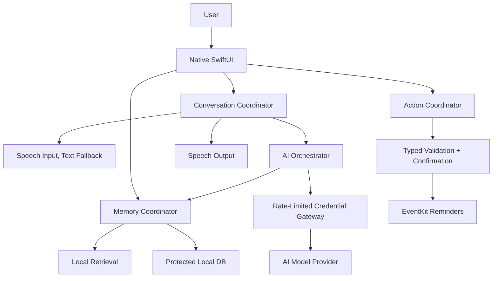

# DODDY HQ — Revised Product & Development Blueprint
**As of 8 October 2026 · Status: evidence-based working specification, not legal sign-off or live device verification**

## 1. Decision summary
Build Doddy incrementally from the current native SwiftUI prototype. Test the product hypothesis: **“Tell it before you forget. Ask it when you need it.”** Preserve the wider brand promise **“Your mate in your pocket.”** Start with a trustworthy explicit capture/retrieve experience and a real AI text pipeline, then physical-device voice; add one controlled external action (Apple Reminders) before expanding to sync, accounts, and autonomous agents.

### Known versus unknown
**Confirmed from inspected repository source:** `AssistantController` contains a state machine with cancellation/session tokens; `TalkToCompanionIntent` and `InvocationRouter` implement App Shortcut integration; `SpeechService` and `AIService` are mocked; `MemoryItem` preserves original and corrected note text, dates, provenance and legacy decode; `LocalRecallService` does lexical candidate matching; `AppState` persists JSON using `UserDefaults`. The repo contains memory-recall test source and a product/business documentation pack.

**Not verified:** Current native Xcode build, execution of the test suite on this revision, physical Back Tap, real microphone/audio latency, customer demand and retention, willingness to pay, real service usage/billing, legal compliance, secure release readiness. The prototype is not a live voice assistant.

**Important code issue:** The `AppState` persistence helper discards encoding errors, and `saveMemory()` can report success without an independently verified durable write. The `deleteAllMemory()` implementation also clears a prior corruption flag; its recovery implications need an explicit test and remediation.

## 2. Product and MVP
**Proposed initial cohort:** Adult iPhone users who already save useful recommendations, commitments, decisions and small facts in Notes, Reminders or self-messages. Recruit based on demonstrated behavior, not enthusiasm for AI.

**MVP must do:** Real text entry and AI responses; explicit personal memory capture with displayed success only after confirmed storage; inspect/edit/copy/delete/export; source-aware retrieval that cannot invent personal data; graceful no-match/conflict paths; basic settings; accessible UI; safe errors. A public voice-first proposition additionally requires real speech capture, audio output, interrupt/recovery and device test results. Shortcut entry should remain optional.

**Defer:** Unbounded cloud memories; vector infrastructure before accuracy tests; Gmail/Calendar integrations; unlimited realtime voice; Android; autonomous multi-step tasks; mandatory accounts before first value; ambient background microphone; intrusive automatic extraction of memories; Dynamic Island as an unrestricted overlay.

## 3. Ordered delivery with parallel workstreams
1. **Baseline and audit:** Compile the actual app, run native tests, record environment/results; preserve current source before migrations.
2. **Product requirement approval:** One primary user job, core paths and acceptance criteria; decide how and when voice is required.
3. **Data integrity:** Atomic protected local persistence, non-destructive migration, failure states, deletion/export, no fake save success.
4. **Real AI text loop:** Secure backend key custody, quotas, modeled request/response failures, grounded memory injection and evaluated non-answer behavior.
5. **Voice:** Compare Apple Speech/TTS plus model pipeline versus full-duplex realtime session; validate Polish/English, latency, interruption, permissions, costs on actual devices.
6. **UX/character:** Approved orange/ink/cream brand tokens, reduced-motion support, source-aware memory UI and clear character listening/thinking/speaking states. Design and engineering proceed in parallel.
7. **Verified action:** Typed Reminder proposal, user-confirmed date/timezone, EventKit adapter, permission denial and idempotency/reconciliation.
8. **Security/legal:** Data inventory, lawful bases, retention, third-party agreements, access controls, source transparency, appropriate GDPR/AI Act and App Store assessment; gate release, not documentation alone.
9. **Private/TestFlight beta:** Incident-free core functionality, source-grounded QA matrix, content-free telemetry, 20–24 user observational cohort, distinct taught vs spontaneous usage.
10. **Commercial decisions:** Establish retention and measured unit economics before pricing, StoreKit, cloud sync or larger acquisition efforts.

## 4. Proposed reference architecture

Only SwiftUI shell, mock assistant boundary, local model/recall and App Shortcut are implemented today. The remainder is proposed.

**Decisions to make consciously:** Protected JSON vs SQLite/SwiftData; how to migrate safely; local versus cloud audio privacy; iOS 17 compatibility versus newer controls; whether account-free first use is sufficient; final UX between old cream/mint screens and orange stick-figure identity; realtime voice economics.

## 5. Essential implementation rules
- Never confirm persistence until write succeeds; write atomically and retain pre-migration source until read-back validation succeeds.
- Keep exact accepted memory text (`rawText`) distinct from subsequent corrections (`text`); no invented historical dates.
- Retrieve actual saved record IDs, not free-form model assertions; show ambiguity and original provenance.
- Protect provider credentials server-side; use quotas, validation and content-minimized logs.
- Handle unknown device/locale availability for Apple on-device models, and unsupported language fallbacks.
- Model/third-party content is untrusted: cannot grant permissions, execute direct app writes, or approve its own actions.
- Perform external writes only through typed, user-authorized adapters; verify save response and prevent duplicates.
- Delete/export behavior must account explicitly for local stores, eventual backups, remote provider retention and external reminders.

## 6. Specific technical correction identified in October 2026
Apple now marks `AppIntent.openAppWhenRun` as deprecated in favor of `supportedModes`; Doddy currently uses `openAppWhenRun = true`. Do not blindly replace it without testing compatible modes against the app's minimum OS and both app/extension launch contexts. Reference: https://developer.apple.com/documentation/appintents/appintent/openappwhenrun-475kn and https://developer.apple.com/documentation/appintents/appintent/supportedmodes.

WidgetKit Controls support user-placed Control Center, Lock Screen and Action Button controls but require additional implementation: https://developer.apple.com/documentation/widgetkit/controls-collection. Back Tap assignment is user-configured; it cannot be silently enabled. ActivityKit Live Activities are bounded system surfaces, not persistent overlays: https://developer.apple.com/documentation/activitykit/displaying-live-data-with-live-activities.

Apple Foundation Models availability depends on device, region and model readiness. Test `SystemLanguageModel.availability` and language support rather than assuming a universally available local model: https://developer.apple.com/documentation/foundationmodels/systemlanguagemodel.

## 7. Security/legal workstream
**Before external release:** threat model; personal-data map; permissions and processor review; valid lawful bases and clear notices; protected storage; data rights and deletion; logging minimization; provider transfer assessment where relevant; AI transparency and appropriate App Store declarations. Distinguish legal requirements from design preferences. Consult qualified counsel for applicability and unresolved legal interpretation.

Official sources:
- EDPB privacy by design and accountability: https://www.edpb.europa.eu/sme/be-compliant/be-compliant_en
- EU AI Act Article 50 transparency guidelines, applicable from 2 August 2026: https://digital-strategy.ec.europa.eu/en/policies/guidelines-ai-transparency-obligations
- Apple review rules: https://developer.apple.com/app-store/review/guidelines/
- Apple account deletion when account creation is offered: https://developer.apple.com/help/app-review/guideline-reference/5-1-1-account-deletion
- Apple EventKit reminders: https://developer.apple.com/documentation/eventkit/creating-events-and-reminders

## 8. Unit economics: hypotheses, not forecast
The repo's illustrative model assumes an $8 pre-tax subscription with a **hypothetical** 15% store deduction ($6.80 net), plus costed usage. As of the reviewed Oct 2026 published model card, GPT-Live 1 sessions cost $0.05/minute billed per second; backend reasoning and tools cost extra: https://developers.openai.com/api/docs/models/gpt-live-1 .

| Segment | Minutes/mo | Voice only | Total modeled variable cost | Net contribution after $6.80 |
|--|--:|--:|--:|--:|
| Light | 7 | $0.35 | $0.90 | +$5.90 |
| Typical | 40 | $2.00 | $2.85 | +$3.95 |
| Heavy | 216 | $10.80 | $12.65 | -$5.85 |

These are not observed customers or a legal statement of the applicable store commission. Reconcile actual developer eligibility, EU terms, taxes, actual billed minutes, free users and customer acquisition before a pricing commitment.

## 9. Evidence-based release gates
- **Prototype:** Known local demo is reproducibly tested.
- **Functional MVP:** Protected storage and source-aware retrieval; real text AI; critical security controls; documented failure recovery; tested acceptance.
- **Private Beta:** Voice, if marketed, verified on physical devices; privacy notice/permissions; relevant tooling; crash monitoring; no critical open data-integrity issues.
- **TestFlight:** Native QA and participant onboarding/consent processes, published privacy disclosures, support contact, correct external builds.
- **Public App Store:** All applicable legal/security/Apple requirements confirmed, App Store assets and product disclosures reviewed, no critical release blockers.
- **Commercial:** Real retention and unit economics; purchase lifecycle tested if charging users.

**Gate logic:** A high aggregate completion percentage cannot override one failed mandatory condition. “Verified Complete” requires all mandatory acceptance criteria plus an evidence reference; merely recording a commit is not proof of behavior.

## 10. Suggested tracking and information architecture
Maintain tasks with stable IDs, user-editable notes and subtasks, acceptance criteria, dependency edges, risk/priority, evidence types, revision history and links to primary documents. Keep `verified implementation`, `proposal`, `assumption` and `unknown` distinct. Provide JSON import/export, browser-local persistence and explicit scope labels. Never confuse the dashboard's stored checklist state with real GitHub or iOS runtime status.

Recommended sections: Overview; Roadmap; Tasks; Research; Architecture; Decisions; Product & Design; Release Readiness. Feature workstreams cut across phases. One source of truth for product requirement decisions; historical packs remain indexed, not automatically authoritative.

## 11. First ten actions
1. Reproduce native build/test on the latest commit and record artifacts.
2. Approve narrowed product promise, cohort, MVP and excluded scope.
3. Select and document a trustworthy local storage contract.
4. Implement migration/atomic persistence with error surface and device protection tests.
5. Audit `deleteAllMemory` behavior when current store is corrupt.
6. Connect local candidate retrieval to native source-aware memory UI.
7. Build server-held-key AI gateway with quotas and transcript-minimizing logs.
8. Integrate actual text AI and memory-grounded response evaluation.
9. Benchmark Apple speech pipeline versus realtime voice on target physical iPhones.
10. Implement privacy/security beta gates and run a two-week observational user test.

## 12. Source repository
- README: https://github.com/Bienos/AI-AGENT-DODDY/blob/main/README.md
- Product spec: https://github.com/Bienos/AI-AGENT-DODDY/blob/main/docs/product/PRODUCT_SPEC.md
- Engineering: https://github.com/Bienos/AI-AGENT-DODDY/blob/main/docs/product/ENGINEERING.md
- Integration: https://github.com/Bienos/AI-AGENT-DODDY/blob/main/docs/product/INTEGRATION_REPORT.md
- Validation: https://github.com/Bienos/AI-AGENT-DODDY/blob/main/docs/product/VALIDATION.md
- Business model: https://github.com/Bienos/AI-AGENT-DODDY/blob/main/docs/product/BUSINESS.md

## 13. Scope and remaining uncertainties
This blueprint is grounded in reviewed source and official links. It does **not** represent new execution of Xcode tests, an independent comprehensive codebase review, a deployment security audit, an intellectual-property clearance, or an external customer study. Those remain actionable requirements rather than claimed achievements.
